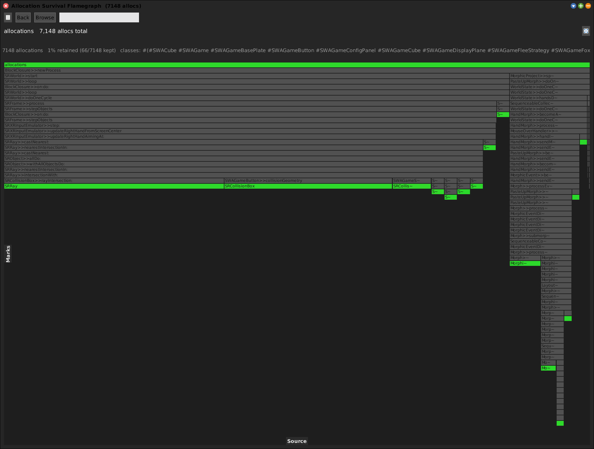

# Trace Allocations (Alloc Tracer)

[Gallery index](index.md) · referent **event** · extent **interval** · **Record** (until stop)

> Which *code paths* allocate these objects -- and is what they make kept?

The complement of every heap tool: they attribute **retention**, this attributes
**creation**. A flamegraph where each frame is a `Class>>selector` on the
allocation stack, width is allocations beneath it, the deepest frames are the
allocated classes themselves, and colour is survival -- **red = kept, green =
collected**.

Journal: [2026-08-18](../../../journal/2026-08-18-allocation-survival-flamegraph-and-the-set-dont-new-question.md).

**Open:** `SWA Event: Trace Allocations (until stop)`, or
`SWAAllocTracer openTraceUntilStop`.

<!-- SCREENSHOT gallery-alloctracer.png -- Record tool: arm, do something, then STOP. Not scriptable in one go.
| panel |
panel := SWAAllocTracer openTraceUntilStop.
"...do the one thing (a second or two is plenty), then press STOP, then:"
"PNGReadWriter putForm: w imageForm onFileNamed: 'squeak-object-space-tally/doc/media/gallery-alloctracer.png'."
-->

## What it traces

`SWAAllocTracer tracedClasses` defaults to the **working set**, expanded to its
classes -- what you are developing in is what you trace, and editing the working
set (from the **Packages** list in any pane) moves both in lockstep. Pin an
explicit set with `traceClasses:` / `traceClass:` / `stopTracingClass:`;
`resetTracedClasses` goes back to following the working set.

## The funnels, and the universal one

Wrappers are installed not per class but on each class's **allocation funnel** --
the constructor it actually routes through, auto-detected: `Array class>>new:` for
indexables, `ExternalStructure class>>new`, `Vector class>>new`, and so on. A whole
family installs one wrapper.

A class with no dedicated allocator inherits plain `Behavior>>new`, so a broad
working set lands on a **universal funnel** that fires on essentially every
allocation in the image. That is allowed and warned about, and it is why this is a
short, one-shot, always-`disarm`ed capture.

## The context gate

The wrapper's first act is to consult a **default-off gate**, so allocations
elsewhere pay only that probe plus a fast forward. Three states:

- explicit **true** (`captureDuring:`, used by the frame-exact XR captures),
- explicit **false** (`withGateOff:`, which stops the tracer's own fold
  re-entering),
- **absent** -- follow the global `captureAll:` flag.

`openTraceUntilStop` sets the global flag, so a live trace sees **every process**:
the UI process, the XR world's render process, and the MCP server too. That last
is the price of seeing the XR world at all -- it renders in its own process, so a
per-process gate would miss it.

## Scale

Measured on a desktop with an XR world running: **~33,700 allocations in 400 ms**,
96% of it `RlVector3` + `RlColor` from `SRCube>>renderOn:`. So a 10-second trace is
roughly 800,000 allocations, with a universal funnel taxing every `new` for the
duration.

Press STOP quickly. If the render loop drowns everything else, either
`stopTracingClass:` the two hot classes, or narrow the working set -- dropping
`Morphic` also drops the universal funnel.

## Phases

The run panel names each one, because the slow part is not the one you would
guess:

1. `Instrumenting N classes ...`
2. `Tracing N classes in every process. Do the one thing, then press STOP.`
3. `Measuring survival (full GC + survivor sweep) ...` -- the slow one.

Survival is scored **after** the wrappers are uninstalled, so the measurement walk
is not itself traced.
