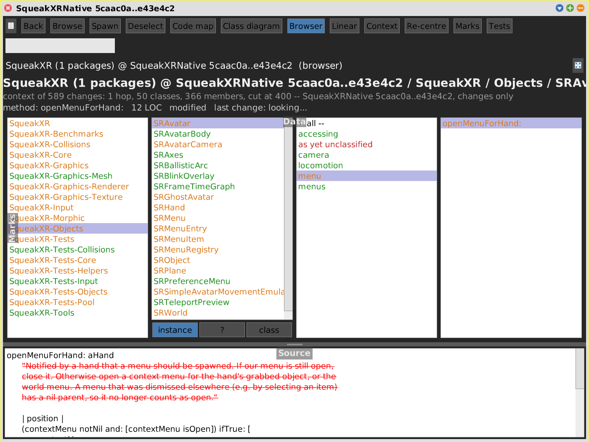

# Browser

[Gallery index](index.md) · referent **code** · extent **timeless** (or a commit range) · **Look**

> Where exactly is it, and what does it say -- with the range and the review state still visible?

The third view of the code pane (`SWACodeBrowser`, category `SWA-CodeBrowser`): the
four columns of the System Browser -- package, class, method category, method --
over the **same `SWACodeNode` tree** the [Code Map](code-map.md) and the
[Class Diagram](class-diagram.md) draw. The Source flap is its code pane. It exists
so that reading and editing code does not mean leaving the picture: switch to it,
and the range, the Full picture / Changes only / Live image mode, the zoom and the
selection all come along.

Journal: [2026-10-23c](../../../journal/2026-10-23c-a-system-browser-inside-the-code-pane.md).

**Open:** the **Browser** button of any code pane (there is no menu entry of its
own). Switching into it opens the Source flap.

<!-- SCREENSHOT browser-range-changes.png -- needs the SqueakXRNative repository in the image.
Off-screen, see "Screenshot recipes" in index.md for the window boilerplate.
view := SWACodeTreemapMorph on: root.   "root: SWACodeRootNode on 'SqueakXR', overlay wired"
view setRepository: 'SqueakXRNative' from: '5caac0a' to: 'e43e4c2'.
view loadGitRange. view rangeView: #changes.
"...pane + window..."
view selectedNode: (view keyIndex at: 'SRAvatar>>openMenuForHand:').
pane switchToCodeView: #browser.
win fullBounds. win fullBounds.
-->

## The columns

| Column | Lists | Notes |
|---|---|---|
| Packages | every package and system category, flat, by full name (`SqueakXR-Graphics-Mesh`) | none selected lists every class of the root -- in Changes only, every changed class at once |
| Classes | the classes under the selected package | **instance / ? / class** below; `?` selects the class comment node, so the flap shows the comment (and its diff) |
| Categories | method categories of the chosen side, plus `-- all --` | `-- all --` stays selected while you pick methods from it |
| Methods | the methods of the category | empty until a category or `-- all --` is chosen, as in the System Browser |

A class shows its **definition** in the flap. Clicking the selected item again, or
**Back**, moves one column to the left. The header search field filters all lists
to the matches and their ancestors. A broader package stays selected when the new
selection is inside it, the way the System Browser behaves.

## What it shares with the other views

The browser has no aspect of its own beyond the columns; everything else is a
[shared aspect](index.md#shared-aspects):

- **[Commit range](git-range.md)** -- list items are coloured green / orange / red
  (added / modified / removed, struck out), containers roll up like map tiles.
- **[Reviews](reviews.md)** -- signed-off items fade and turn italic. `r` signs off
  what the code pane shows, `R` everything under the selection. Both letters are
  taken from the lists' type-ahead for this.
- **[Source](source.md)** -- the diff on a range, plain source in the live image,
  **Cmd+S** saves (live image only). List clicks ask before throwing away unsaved
  edits.
- **[Context](context.md)** -- in the Context view the lists only hold what the
  context includes.
- **[Linked views](linked-views.md)** -- a selection from another view arrives
  through `revealNode:`, which points every column at the node's ancestors; on a
  root swap (live <-> range) `equivalentOf:` finds the same member in the new tree.

Not here yet: [marks](marks.md) (no mark frame on list items) and *Focus marked*.
