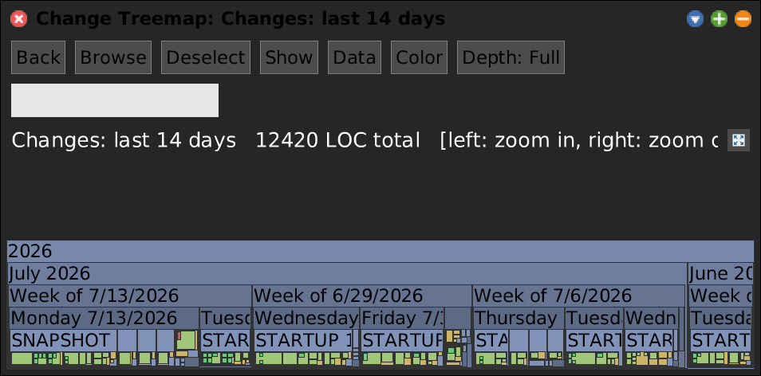
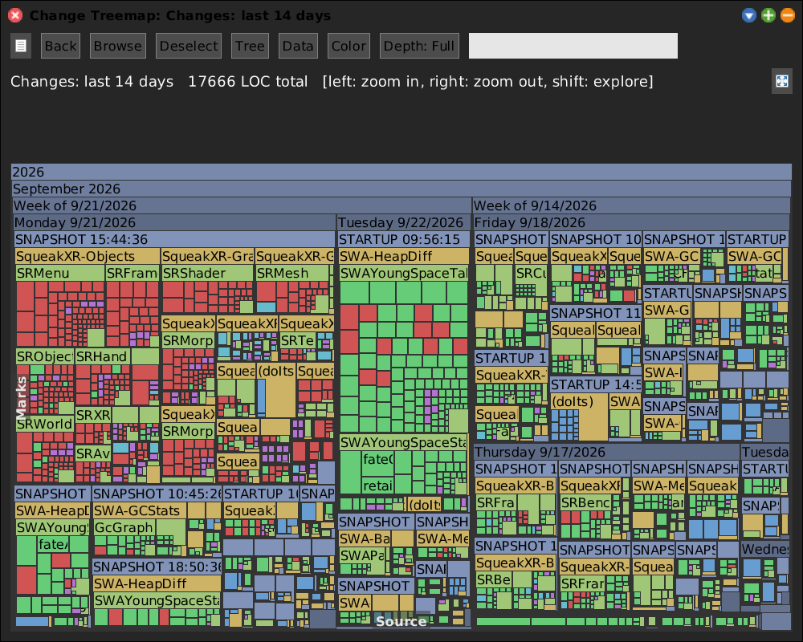
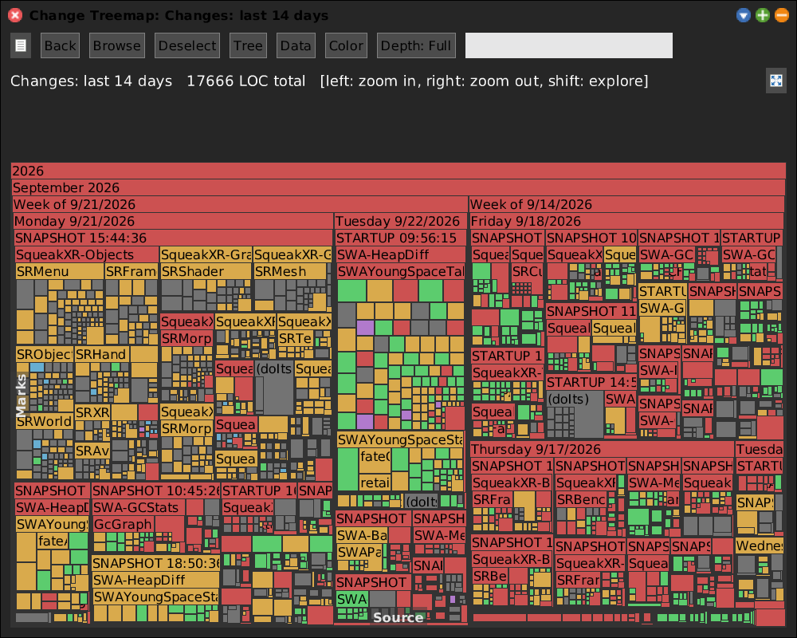
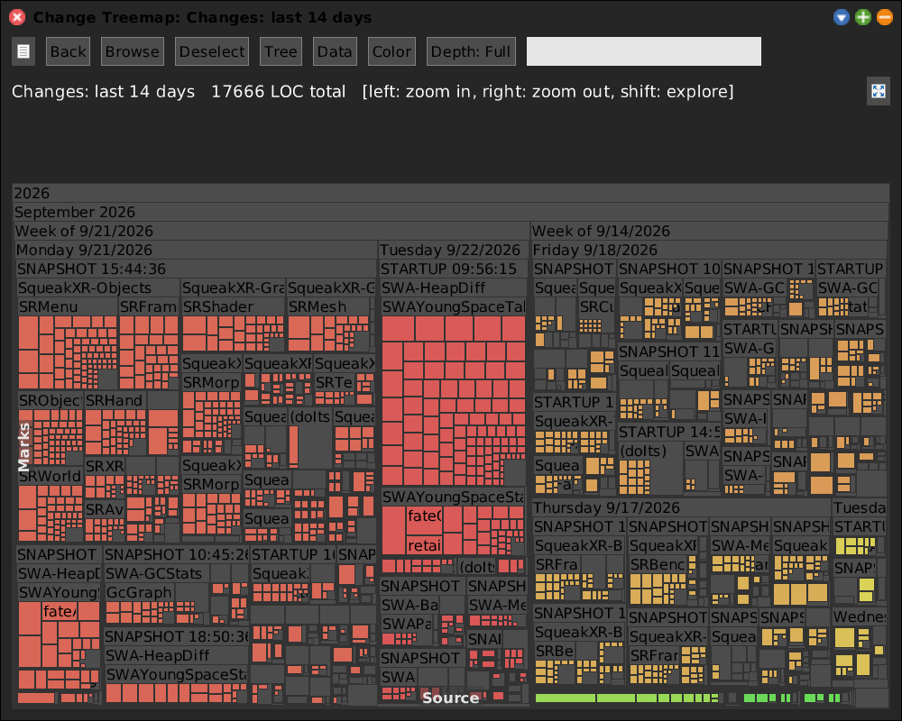
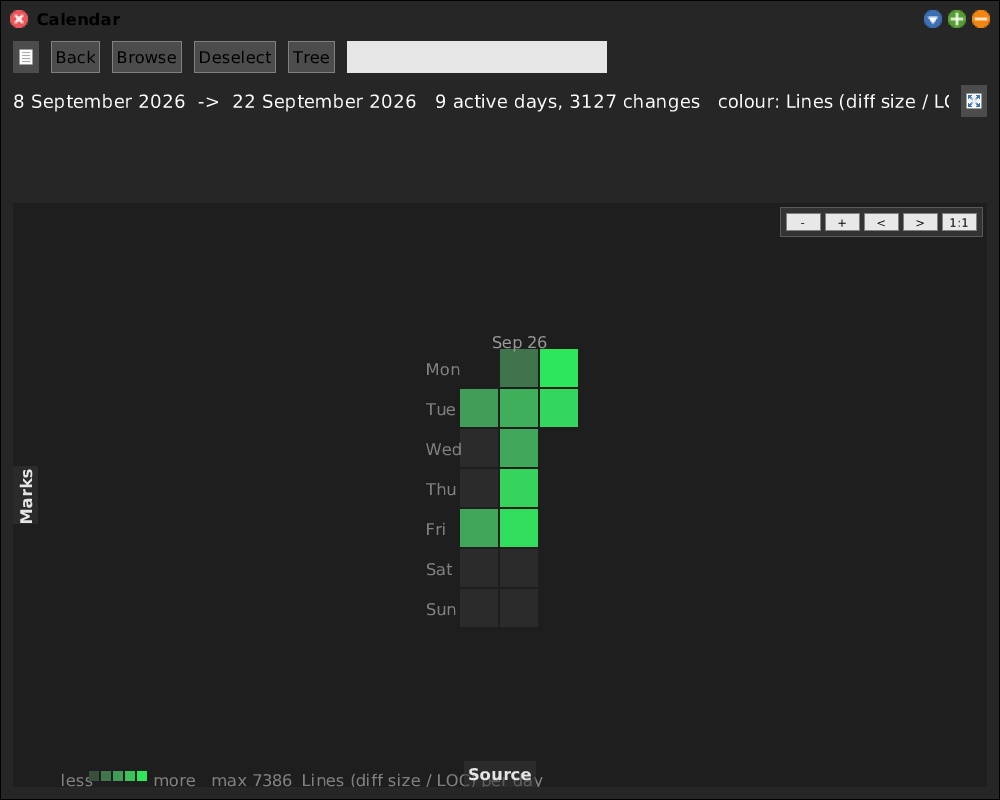

# Change Map

[Gallery index](index.md) · referent **code** · extent **series** · **Look**

> *When* did the code change, and how much?

A time-bucketed treemap over this image's **`.changes` file**
(`year -> month -> week -> day -> save -> package -> class -> change`), tile weight
= diff-line count. Selecting a change shows an inline diff.

Journal: [2026-07-09](../../../journal/2026-07-09-swachangeparser-change-treemap-and-recovery.md).

**Open:** `SWA Code: Change Map` (asks for a number of days), or
`SWAChangeParser openLastDays: 14`.

<!-- SCREENSHOT gallery-changemap.png
| w |
w := SWAChangeParser openLastDays: 14.
World displayWorld. (Delay forMilliseconds: 1500) wait. World displayWorld. (Delay forMilliseconds: 500) wait.
PNGReadWriter putForm: w imageForm onFileNamed: 'squeak-object-space-tally/doc/media/gallery-changemap.png'.
w delete.
-->

## What it sees that git does not

The `.changes` file records **every accept**, including the ones you reverted,
the ones you never committed, and the ones made in an image that was later
abandoned. Git records what survived to a commit. The gap between the two is the
work that left no trace anywhere else.

It is also the recovery tool: the parser is what you reach for when an image
breaks and the last good version of a method is only in the change log.

## Colour modes

*By change kind* -- method / doIt / class / comment / removal. A wall of doIts is
a Workspace session; a wall of methods is real work.

*By status* -- current / superseded / in-history / **gone**. The "gone" tiles are
the interesting ones: code that was written and no longer exists anywhere.

The **Tree** button puts the same edits on a day grid -- the rhythm of the work
rather than its shape.

## Diff mode

`SWAChangeParser openInteractiveDiffChangeMap` picks a **newer** and a **baseline**
`.changes` file and maps what the newer one has that the baseline lacks. Useful
across two images, or across a crash.

Not in the Apps menu since 2026-09-22 -- it was one of the entries pruned as a
specialist. Still one send away.

## Relatives

- [Git Map](git-map.md) draws the same picture from a **git repository** instead,
  and subclasses this one (`SWAGitTreemapMorph` is a `SWAChangeTreemapMorph`).
- [Change Trace](change-trace.md) is the **live** twin: it captures edits as they
  happen, weighted by the memory each one costs, rather than parsing them after
  the fact.
