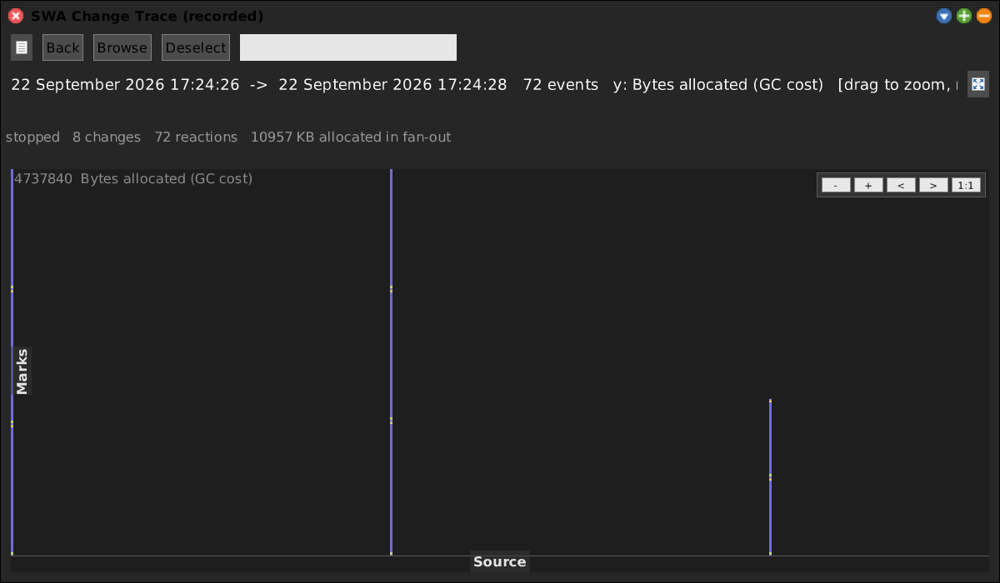
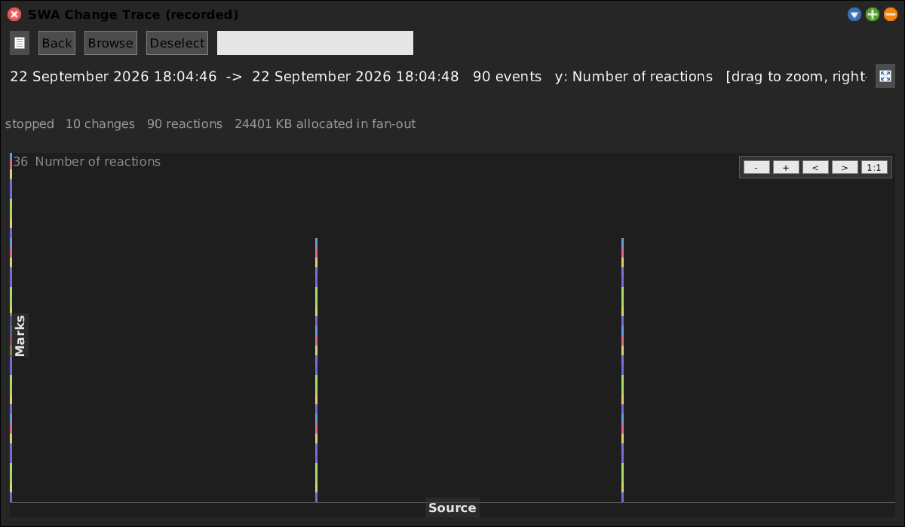

# Change Trace


[Gallery index](index.md) · referent **event** · extent **instant** · **Record** (until stop)

> What does one *live edit* cost -- who reacts, for how long, allocating what?

Every time you change a class or method, `SystemChangeNotifier` fans out
**synchronously** to ~8 subscribers before your accept returns: `GSCodeMapper`
rebuilding dependent sets, `MCWorkingCopy` dirtying working copies, `ChangeSet`,
and so on. This records that fan-out.

**Open:** `SWA Event: Change Trace (until stop)`, or
`SWAChangeTraceRecorder openRecordUntilStop`. `SWAChangeTraceRecorder open`
re-opens the last recording without recording again.



<!-- SCREENSHOT gallery-changetrace.png -- Record tool: start, make a few edits, then STOP.
| panel |
panel := SWAChangeTraceRecorder openRecordUntilStop.
"...edit a few methods, then press STOP, then screenshot the window that opens."
"PNGReadWriter putForm: w imageForm onFileNamed: 'squeak-object-space-tally/doc/media/gallery-changetrace.png'."
-->

## Two levels

| Node | Is | Carries |
|---|---|---|
| `SWAChangeTraceNode` | one edit | microsecond stamp, change type, `Class>>selector`, bytes |
| `SWAChangeReactionNode` | one subscriber's reaction to it | `Receiver>>selector`, duration, bytes |

The edit node sums its reactions; the reactions say **which** subscriber is
expensive. Colour by `#kind` is the change type at the top level and the
*subscriber* below it, so a lane-per-subscriber view shows `GSCodeMapper` paying
the same tax on every edit.

The view is `SWATimelineMorph` reused whole, with bucket height = **bytes**, not
count -- so the GC cost of live-coding is literally the height of the trace.

## What it measured here

A real session, 22 edits:

```
22 changes   110 reactions   5089 KB allocated in fan-out
```

**~230 KB per edit, 5 subscribers each.** And most of those "edits" were Workspace
doIts, not method changes:

```
'SRWorld scavengeAtFrameStart: true'   -> 405,200 bytes, 5 reactions
```

Evaluating a one-line expression in a Workspace costs 400 KB of allocation,
because the doIt is logged as a system change and every subscriber reacts. That is
exactly what **`SWA Workspace (non-logging)`** exists to avoid -- a Workspace whose
doits fire no system-change event, hence no GitS wake and no post-doit GC burst.

## Measures



*By count* -- how many edits, ignoring what they cost. Compare with the default
**bytes** measure above: the two disagree exactly where one cheap edit sits next to
one expensive one, which is the whole point of weighting by memory.

## Why the measurement is cheap

Allocation is read from `vmParameterAt: 34` (bytes since last full GC), a cheap
monotonic-ish counter; a full GC between two events resets it, so a negative delta
is clamped to 0. The delta is measured since the *previously recorded event*, so
it attributes the whole fan-out to the edit rather than to one subscriber.

The recorder is itself one more subscriber, deliberately cheap.

## Note for agent sessions

MCP edits go through the same path. Every `squeak_write_method_code` pays this
tax, so a long agent session is a real contributor to the young-space floor that
[Young Space](young-space.md) reports.
