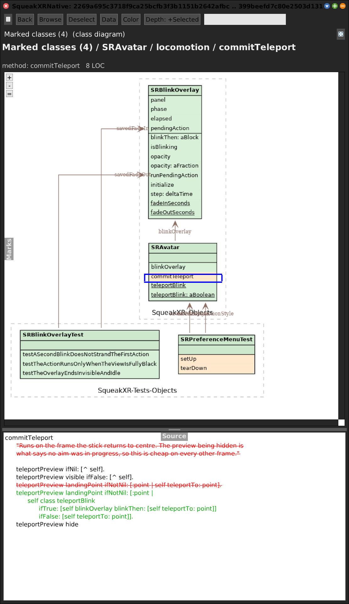
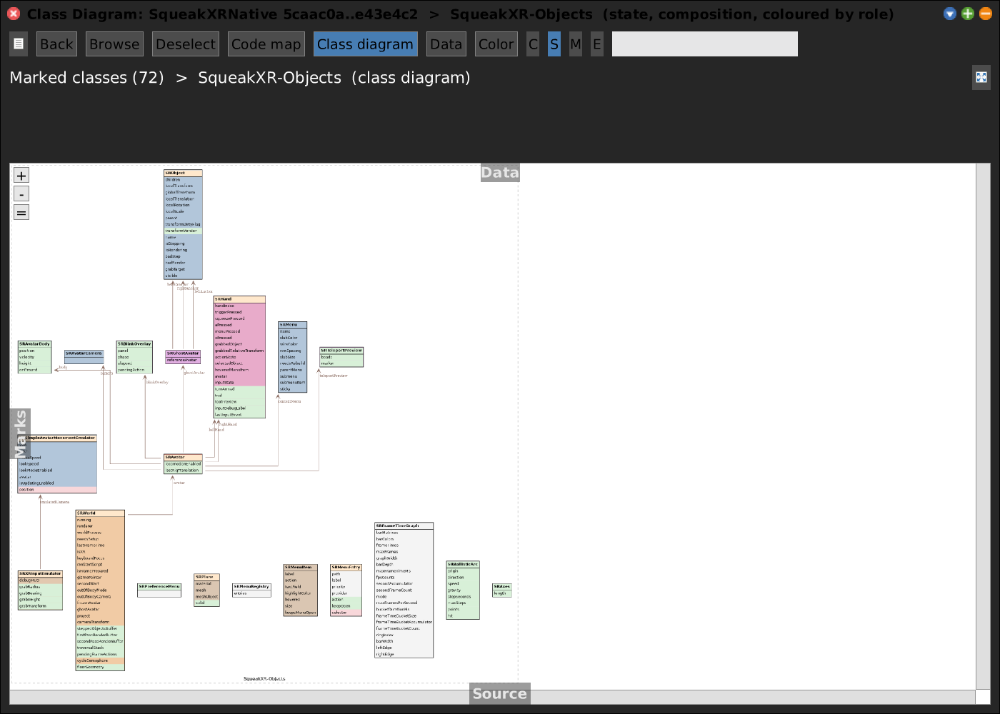
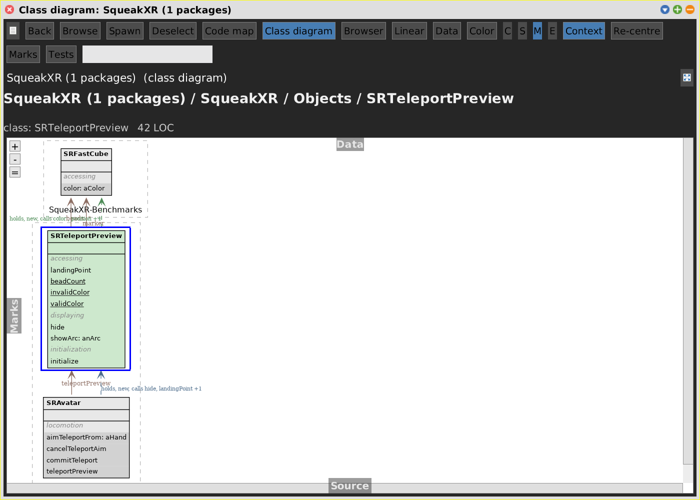

# Class Diagram

[Gallery index](index.md) · referent **code** · extent **timeless** (or a commit range) · **Look**

> What is the *inheritance and composition shape* of these classes -- and what did a range change in it?

A UML-style class diagram on the SWA view layer (`SWAClassDiagram`): record boxes
laid out by **Graphviz**, inheritance and composition edges, packages and system
subcategories as dashed clusters. It is the second view of the code pane, beside the
[Code Map](code-map.md), [Browser](browser.md) and [Linear](linear.md), and shares
their [aspects](index.md#shared-aspects).

Journals: [2026-07-13](../../../journal/2026-07-13-classdiagram-graphviz-json-and-graph-view.md),
[2026-10-21c](../../../journal/2026-10-21c-cleaning-up-for-the-merge-and-a-diagram-that-shows-the-diff.md)
(the range diagram), [2026-10-23b](../../../journal/2026-10-23b-the-code-map-learns-history-and-an-idea-for-xr.md)
(composition data, semantic zoom, one pane with the map).

**Open:** the **Class diagram** button of a code pane; `SWA Code: Class Diagram`
(the working set); `SWA Code: Class Diagram (commit range)`; or
`SWAClassDiagram openOnPackageNamed: 'JSON'`, `openOnMarks`,
`openOnGitRepository: 'SqueakXRNative' from: '5caac0a' to: 'e43e4c2'`.

<!-- SCREENSHOT gallery-classdiagram.png -- small package: the diagram is only legible on small packages
| w |
w := SWAClassDiagram openOnPackageNamed: 'JSON'.
World displayWorld. (Delay forMilliseconds: 800) wait. World displayWorld. (Delay forMilliseconds: 300) wait.
PNGReadWriter putForm: w imageForm onFileNamed: 'squeak-object-space-tally/doc/media/gallery-classdiagram.png'.
w delete.
-->

## Depth

The depth buttons are **C S M E**:

| Button | `leafKind` | Shows |
|---|---|---|
| **C** | `#class` | class boxes only |
| **S** | `#state` | classes + all instance variables |
| **M** | `#method` | classes + all state + all methods |
| **E** | `#selected` | classes + only the **marked** ivars and methods ([marks](marks.md)); on a range, only the **changed** ones |

`#selected` is what makes a large package legible: mark what you care about in
another view, then diagram just that. A range diagram opens at this depth.

## What a box says

- Method rows show the real message pattern, `at: x put: aValue`, not `at:put:`.
- Class-side members are **underlined**, the UML notation.
- Superclasses every class has are suppressed --
  `SWAClassDiagram class>>defaultSuppressedSuperclassNames`, `#('Object' 'TestCase'
  'SRObject')`. On the XR branch that took 135 edges, most converging on one
  `Object` box, down to 65 that each mean something.
- System subcategories (`SqueakXR-Core`, `SqueakXR-Objects`) are dashed clusters.
- **Composition edges** (brown, labelled at the head with the ivar name, where UML
  puts a role name), inferred statically: `camera := SRAvatarCamera new` names a
  type, and an `add:` sent to an ivar names a collection's element type. Value types
  and containers are left out or every arrow would point at `Vector3`. The gap is
  dependency injection: an ivar only ever set from a parameter shows no edge.

## On a commit range

Rows are coloured by change kind -- green added, orange modified, **red struck
through** removed, on the class that lost them and in the compartment they belonged
to. That is what makes a rename or a pull-up legible: `SRAvatar` shows
`cameraPosition:target:up:` struck beside the live `cameraLocalPosition:target:up:`.
The Source flap shows the **diff** ([source.md](source.md)); review sign-offs are
**markers** on the rows ([reviews.md](reviews.md)). See [git-range.md](git-range.md)
for choosing the range.

## Composition as data, and colour

The ivar-type analysis is also a dataset, `SWACompositionData` (JSON format
`SWACompositionData/1`; the context menu's **Composition** submenu re-analyses,
saves and loads it, the Code Map's Data menu generates it). It is **name-based**, so it
works on git-built classes that have no compiled methods. Its colour layers, in the
diagram as box fills and in the Code Map as tile colours:

| Color | Means |
|---|---|
| by role | **blue** held by others, **orange** holds others, **magenta** both |
| by used-by / by uses | how many classes hold it / it holds |

The Color button also offers `kind` (flat, the default) and `loc` (LOC heat):

## Context

With a [context](context.md) on, the diagram draws the selection's neighbours with
**dashed, labelled dependency edges** -- blue what reaches it, green what it
reaches -- and cuts each context class down to the members that relate it.

## Semantic zoom, export

- **Zoom into** (right-click) goes to the selected class's subcategories, then the
  class; **Back** widens one level. The diagram keeps its full root and draws a
  filtered copy, because the root may be the very tree the Code Map is showing.
- **export PDF...** and **export DOT...** in the context menu run the same pipeline as
  the screen (including the gvpr edge-label pass), so the file has the on-screen
  layout. The SqueakXRNative PR figures were made this way.
- `+` / `-` / `=` zoom the rendered graph.

## Legibility, and the cost

The diagram is only readable on small sets. A Graphviz layout of a few hundred
classes is a wall -- *a diagram of everything is a diagram of nothing*. Narrow it
with one package, the marks, depth **E**, a zoom, or a context. This is also why
the old **containment graph** mode was removed: the treemap Code Map supersedes it.

`dot` runs synchronously and **blocks the image**: ~1.3 s for 51 classes, 5-11 s
for a range diagram with many changes.

## Notes

- `SWAClassDiagram` had no `setRoot:` until 2026-09-22, so **Add / Remove / Reset
  package** on a diagram pane raised `doesNotUnderstand:`.
- The cross-reference into a diagram reads what the diagram **draws**
  (`displayedCrossRefKeys`), not every member it holds -- see
  [linked-views.md](linked-views.md).
