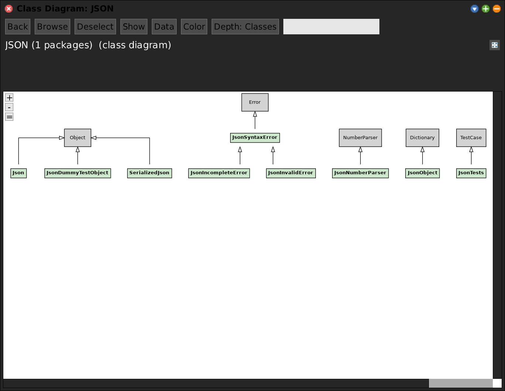
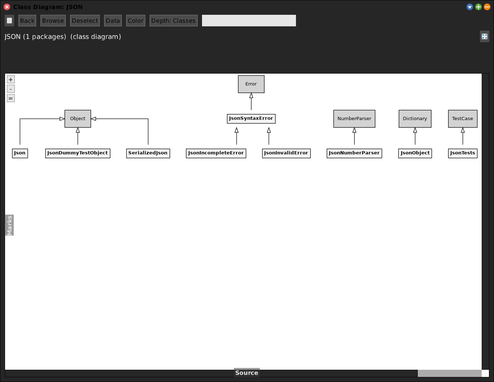
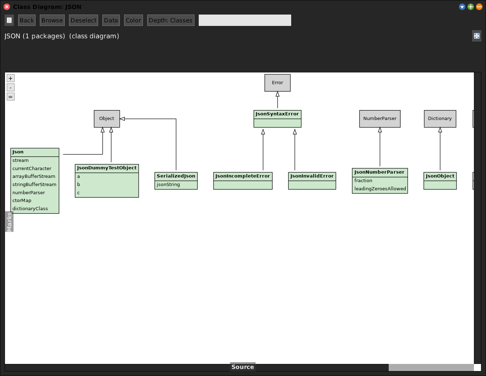

# Class Diagram

[Gallery index](index.md) · referent **code** · extent **timeless** · **Look**

> What is the *inheritance shape* of these packages?

A UML-style class diagram on the SWA view layer (`SWAClassDiagram`): record boxes
plus inheritance edges laid out via **Graphviz**, external superclasses as
lightgray placeholders. Click a class or a field row to drive selection; the
**Color** and **Tree** buttons work as everywhere else.

Journal: [2026-07-13](../../../journal/2026-07-13-classdiagram-graphviz-json-and-graph-view.md).

**Open:** `SWA Code: Class Diagram` (opens on the working set), or
`SWAClassDiagram openOnPackageNamed: 'JSON'`, or `openOnMarks` for the marked
classes.

<!-- SCREENSHOT gallery-classdiagram.png -- small package: the diagram is only legible on small packages
| w |
w := SWAClassDiagram openOnPackageNamed: 'JSON'.
World displayWorld. (Delay forMilliseconds: 800) wait. World displayWorld. (Delay forMilliseconds: 300) wait.
PNGReadWriter putForm: w imageForm onFileNamed: 'squeak-object-space-tally/doc/media/gallery-classdiagram.png'.
w delete.
-->

## Granularity

`leafKind` controls how much of each class is drawn:

| `leafKind` | Shows |
|---|---|
| `#class` | class boxes only |
| `#state` | classes + all instance variables |
| `#method` | classes + all state + all methods |
| `#selected` | classes + only the **marked** ivars and methods |

`#selected` is the one that makes a large package legible: mark what you care
about in another view, then diagram just that.

## Legibility

The diagram is only readable on small packages. A Graphviz layout of a few hundred
classes is a wall. The menu entry opens on the working set, which may well be too
big -- if so, use `openOnPackageNamed:` with one package, or `openOnMarks`.

This is the reason the old **containment graph** mode was removed: it only rendered
acceptably on tiny packages and the treemap Code Map supersedes it.

## Colour and granularity

*LOC heat* over the record boxes -- the big classes, without leaving the
inheritance picture.

`leafKind: #state` adds every instance variable as a row. `#method` adds methods
too, and `#selected` narrows to the **marked** ones -- the setting that makes a
large package legible.

## Note

`SWAClassDiagram` had no `setRoot:` until 2026-09-22, so **Add / Remove / Reset
package** on a diagram pane raised `doesNotUnderstand:`. Fixed, together with a
default `layoutProgress:` on `SWAView` that eleven other views were also missing.
