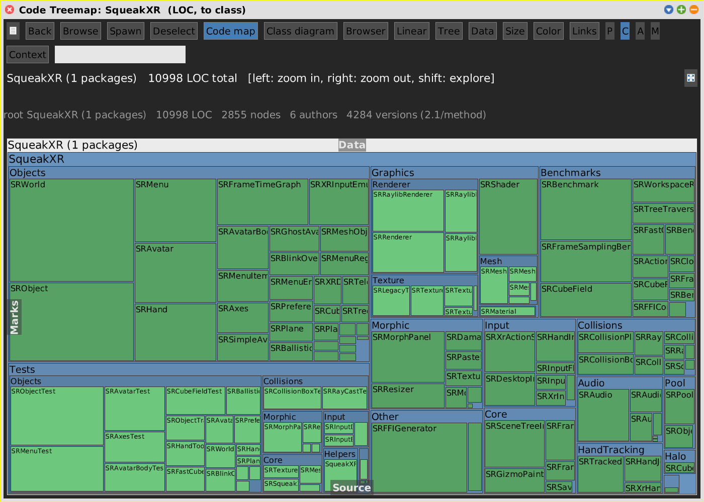
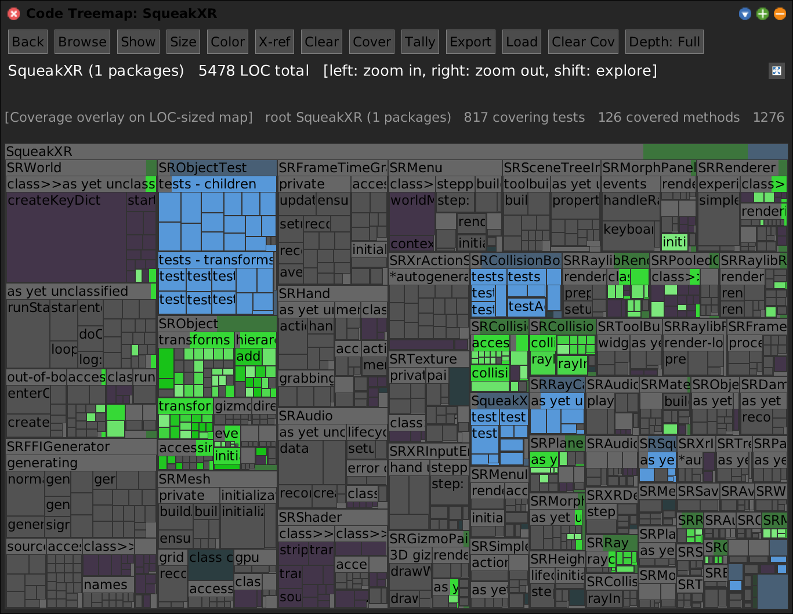
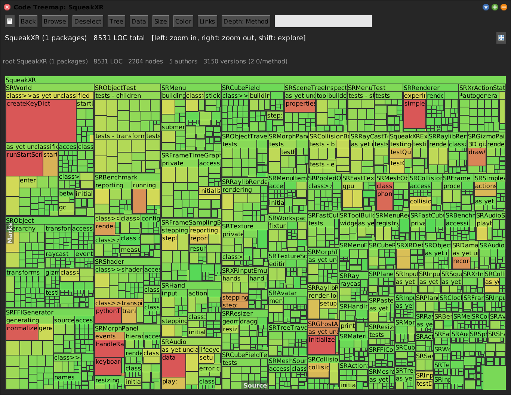
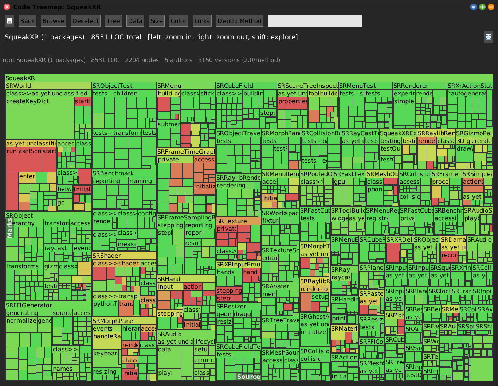
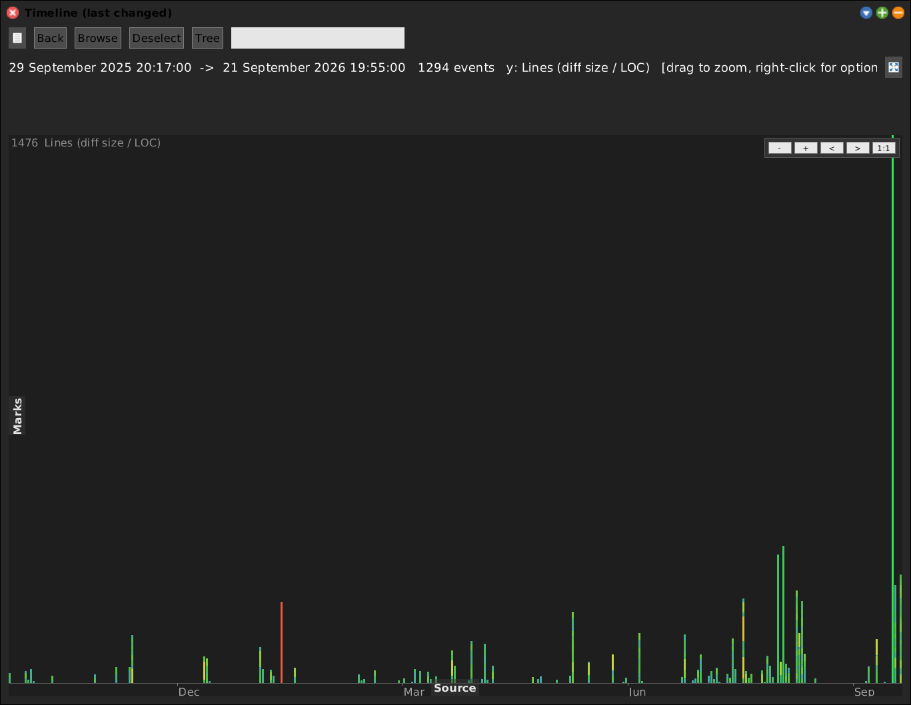
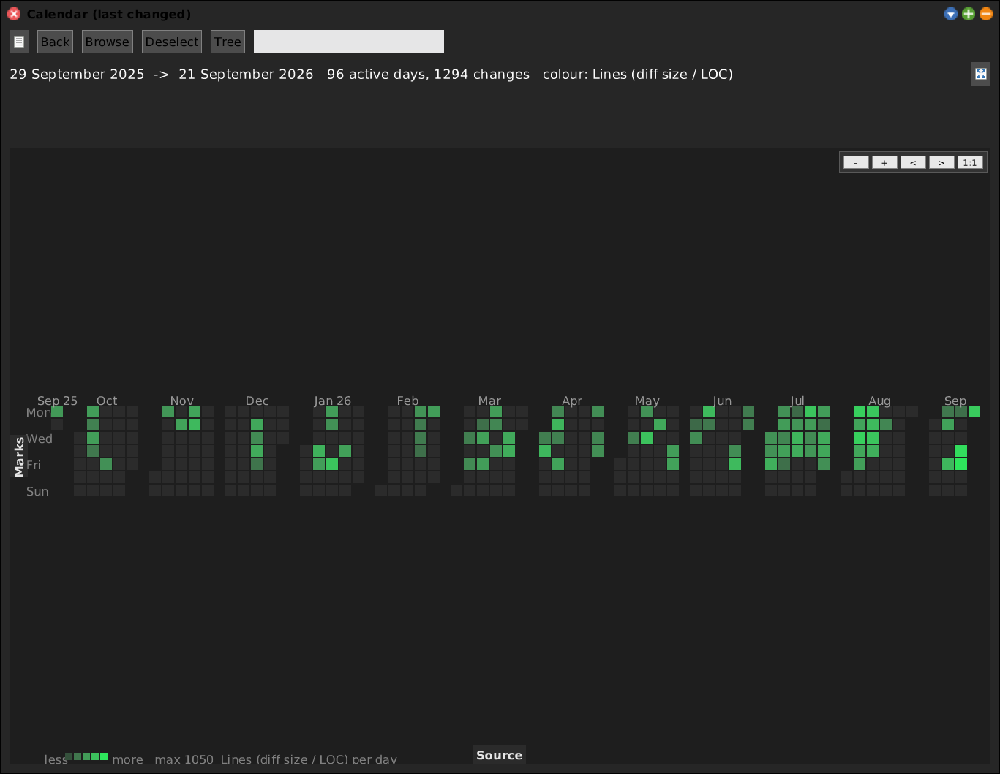
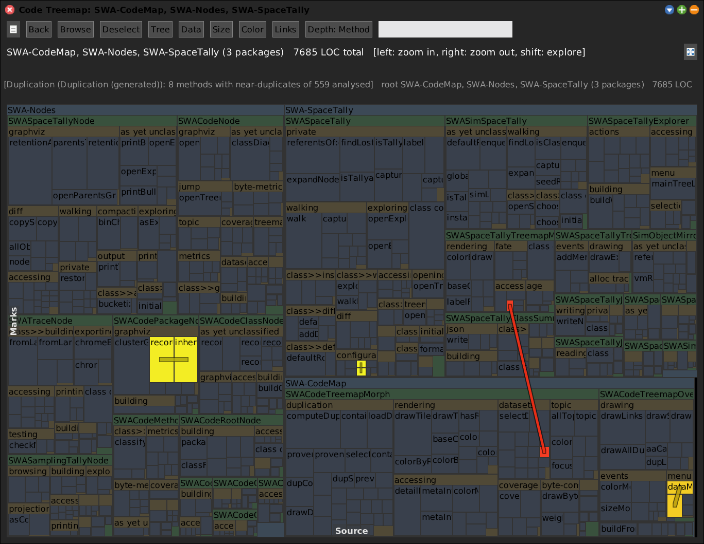
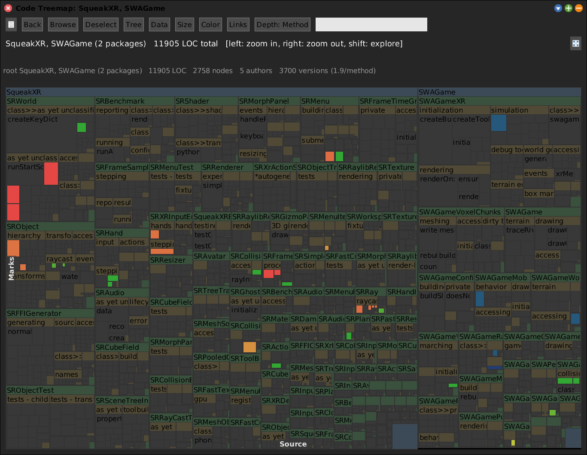

# Code Map

[Gallery index](index.md) · referent **code** · extent **timeless** · **Look**

> What is the *shape* of this code -- size, documentation, coverage, churn?

The **generic tool** of the suite: the `package -> class -> category -> method`
tree as a squarified treemap, where tile **area** is a size metric (LOC / bytes /
method count / execution counts) and tile **colour** is an orthogonal property,
both switched live from the **Size** / **Color** buttons.

Full doc: **[SWACodeMap.md](../SWACodeMap.md)**.

**Open:** `SWA Code: Code Map`, or `SWAPane open`.

<!-- SCREENSHOT gallery-codemap.png
| w |
w := SWAPane openOnPackageNamed: 'SqueakXR' leafKind: #class.
World displayWorld. (Delay forMilliseconds: 500) wait. World displayWorld. (Delay forMilliseconds: 200) wait.
PNGReadWriter putForm: w imageForm onFileNamed: 'squeak-object-space-tally/doc/media/gallery-codemap.png'.
w delete.
-->

## Scope: the working set

The menu entry opens on the **working set**, not on `'*'`. The old default was
every package in the image, which is slow to build and unreadable -- the packages
you care about are a few pixels wide next to Etoys and Morphic.

Edit it from the map itself: the **Packages** list in the Marks flap, then
**Default** to store it. It is also
`SWAPane class>>codeMapWorkingSet`, a preference under category *SWA*.

That same working set decides what several other tools measure -- see
[alloc-tracer.md](alloc-tracer.md) and [trace.md](trace.md).

## Why one map answers many questions

Area and colour are independent, and datasets stack onto the same `crossRefKey`
vocabulary. So a single map can answer *which classes are large, comment-heavy,
recently churned, poorly covered, or duplicated?* without rebuilding anything.

Datasets it loads: coverage, duplication, topic model, git churn
([git-map.md](git-map.md)), space tally ([space-tally.md](space-tally.md)), and
any live peer panel.

## More colour and tree modes

Colour and area are independent, so each of these is the same tree asking a
different question.

*By avg LOC / method* -- hot tiles are classes whose methods are long on average,
which is a decomposition smell rather than a size one.

*By avg versions / method* -- how often this code has been **rewritten**, from the
change log. High-version code is where the design has not settled.

The **Tree** button redraws the same nodes on a time axis, because code nodes
answer `eventTimeStamp` (their last-changed date):

## Datasets, pictured

**Duplication**, generated in place from the Data menu (`Generate` is the async
twin of `Load` -- it forks at background priority and installs the result on the
UI process, so it never wedges the image).

**Peer cross-reference.** No file, no export: every open treemap/flamegraph shows
up in the **Data** menu as *"X-ref: `<window>`"*, and picking it colours this map
by that panel's live `keyIndex`. Above, a Code Map of `SqueakXR, SWAGame` coloured
by an allocation flamegraph of 15,654 allocations captured seconds earlier -- so
the lit tiles are *the classes that allocate*.

## The gap worth knowing

Every structural claim the Code Map makes is **extensional** -- length of the
source text, time of change, vocabulary of its words. Nothing here represents what
a method *does*: what it sends, what it touches, what types pass through it. See
[landscape.md](../landscape.md) section 7; types are the load-bearing gap, because
in Smalltalk the absent call graph follows from the absent types.
