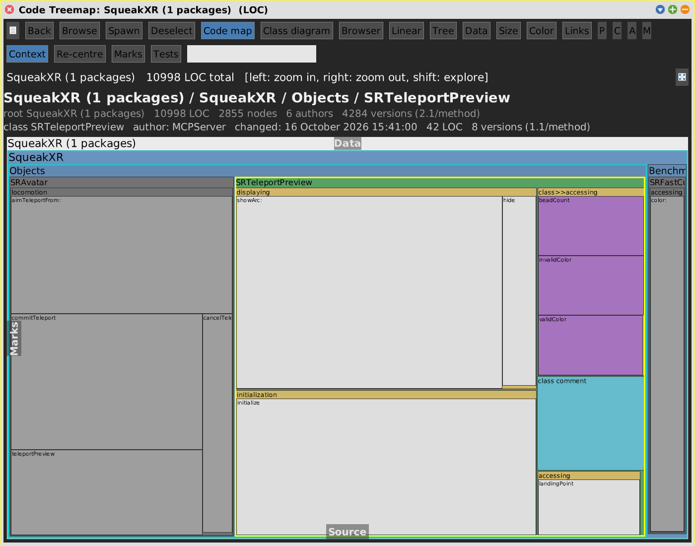

# Context

[Gallery index](index.md) · **shared aspect** of the four code views · new
2026-10-27

> What uses this, and what does it use -- and nothing else?

The **Context** button cuts any code view down to the selection and its direct
neighbourhood: what **reaches** it (senders, references to the class, classes that
hold it by composition) and what it **reaches** (the messages it sends, resolved to
the receiving class where a type can be inferred, the classes it names, the parts it
holds). The two directions are walked apart: a caller of a callee is a sibling, not
a neighbour, and following both would take in most of the image.

Model: `SWASelectionContext` (category `SWA-Nodes`), tested in
`SWASelectionContextTest`. Commit `94480a5` *"show context in code map and class
diagram"*.

**Open:** select a class, method or instance variable and press **Context**. While a
context is drawn three more buttons appear:

| Button | Does |
|---|---|
| **Re-centre** | centre the context on the current selection |
| **Marks** | centre it on every [marked](marks.md) place at once, each with its members -- mark what a document is about, then show it |
| **Tests** | whether tests count as neighbours (off by default) |

On a [commit range](git-range.md) the range-view row has a fourth mode,
**Context**: the changes themselves are the anchors, so the view holds *the changes
and what reaches them or they reach*.

## Code Map

<!-- SCREENSHOT context-codemap.png -- off-screen, live image, no range
view selectedNode: (view keyIndex at: 'SRTeleportPreview').
view recentreContext.
-->

The anchor -- and every member of an anchor's class -- keeps the colour the view
gives it; the context is drawn grey. Everything else is filtered out
(`visibleChildrenOf:` -> `isContextHidden:`), and containers are shown when
something in them is: the context filters the full picture, it does not rebuild it.

## Class Diagram

<!-- SCREENSHOT context-classdiagram.png -- as above, then
pane switchToCodeView: #classDiagram. pane view leafKind: #method. pane updateDepthButtons; refresh.
-->

The diagram is where the context says **how** things are related. Each use that
put a class into the context becomes a **dashed edge**, labelled with what was found
(*"holds, new, calls hide, landingPoint +1"*), coloured by direction: **blue** what
reaches the selection, **green** what it reaches. These are
dependencies, beside the solid composition edges, and are left out of the ranking so
the hierarchy keeps its layout. A context class is cut down to the members that
relate it, shaded a little darker; the anchors' classes stay at the chosen depth.
Superclasses that only context classes have are suppressed -- a superclass is that
kind of neighbour already.

## Browser and Linear

The lists and rows hold only what the context includes. The relation itself is not
drawn; switch to the diagram for that.

## Bounds

- **One hop.** A neighbour is directly related to what is selected or changed, so
  it can be drawn with the arrow that says how.
- **Scope**: the classes of the full picture -- the packages the view shows, or the
  repository's tree on a range. Without a scope, a class named by more than 25 others
  (`Color`, `OrderedCollection`) is left out as generic.
- At most **400** keys; the info line says when it was cut (*"context of 589
  changes: 1 hop, 50 classes, 366 members, cut at 400"*).
- Holders by composition come from a `SWACompositionData` over the scope, computed
  once per root and only up to 1000 classes.
- Receiver types are inferred statically (temps, ivar assignments, return types a few
  sends deep); a send to an untyped receiver reaches no class.
