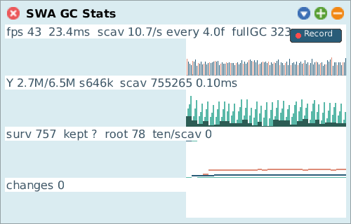

# GC Stats

[Gallery index](index.md) · referent **VM** · extent **series** · **Look**

> What is the *heap* doing over time?

A live graph of frame time, GC activity and object-memory composition, driven from
VM counters. Lanes for FPS, scavenges, full GCs, young/old occupancy, survivors
and live system changes.

Journal: [2026-08-21c](../../../journal/2026-08-21c-gc-stats-memory-lanes-and-the-freeze-hunt.md).

**Open:** `SWA Process: GC Stats`, or `GcGraphMorph open`.

<!-- SCREENSHOT gallery-gcstats.png -- let it run a few seconds so the lanes have data
| w |
w := GcGraphMorph open.
World displayWorld. (Delay forMilliseconds: 4000) wait. World displayWorld. (Delay forMilliseconds: 500) wait.
PNGReadWriter putForm: w imageForm onFileNamed: 'squeak-object-space-tally/doc/media/gallery-gcstats.png'.
w delete.
-->

## Not on the join

This and [Memory Stats](memory-stats.md) are the only tools with **no
`crossRefKey`**. They produce continuous signals with a time axis and nothing to
attach a per-method result to, so they are read against the other tools by shared
**clock**, not by shared key. The [Trace](trace.md) draws the same counters as
bands over its lanes, which is where the two axes meet.

## Reading the survivor lane

Two defects fixed on 2026-09-22, worth knowing because old screenshots lie:

- `kept` was written only when a full GC happened and never aged, so a
  minutes-old number read as current. It now carries its age: `kept 5735 (0s)`.
- `retained` was scaled against `maxSurvivors`, which tracked only *scavenge*
  survivors, so a full GC that kept more pinned the line to the top of the lane
  permanently.

Also: a good share of recent full GCs in this image are **the young-space tools'
own**, so `kept` has been partly measuring the instruments.

## Recording

`SRGCRecorder` records the same series to memory for later analysis in a zoomable
trace pane (`startMorphic` / `stopAndOpen`, or `openRecordUntilStop` for the
STOP-panel version).

Its menu entry was **removed** on 2026-09-22: it sat between this tool, which
already gives the live picture, and [Trace Allocations](alloc-tracer.md), which
attributes allocation to *code* -- which is what the recording was usually being
read for. The class is untouched.
