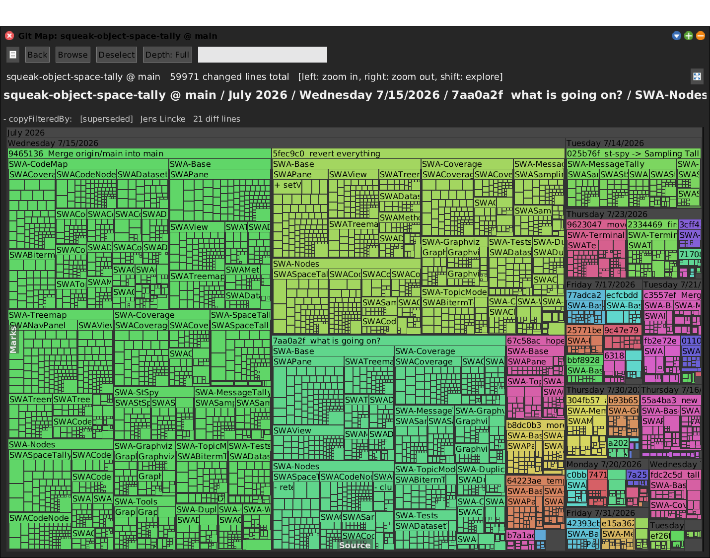
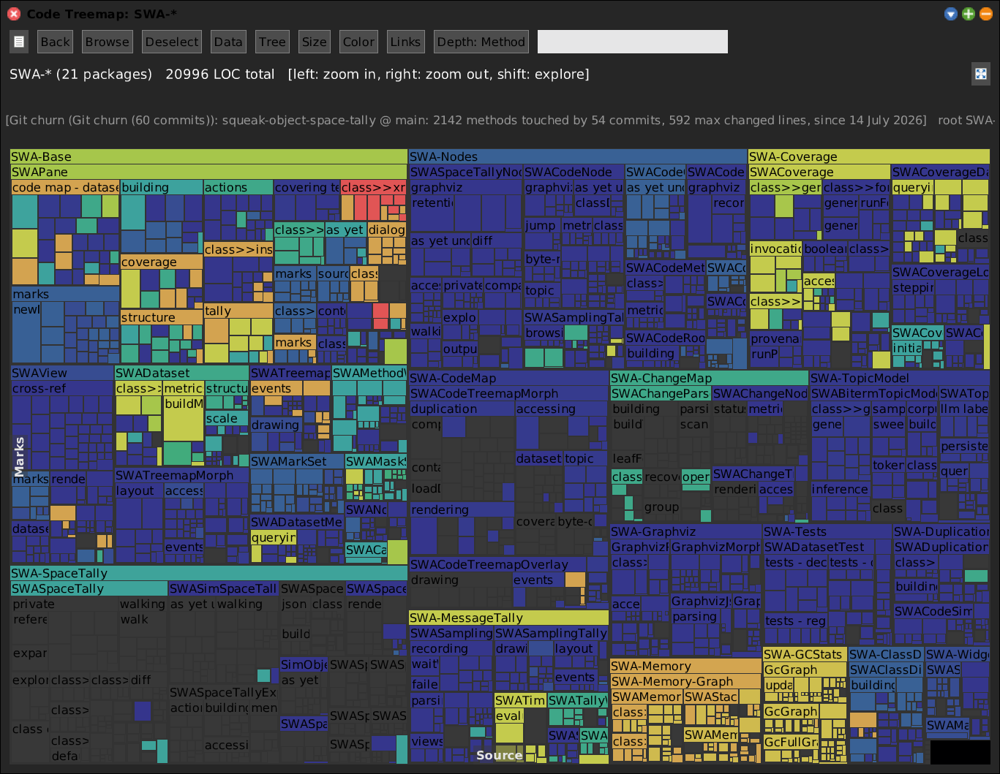
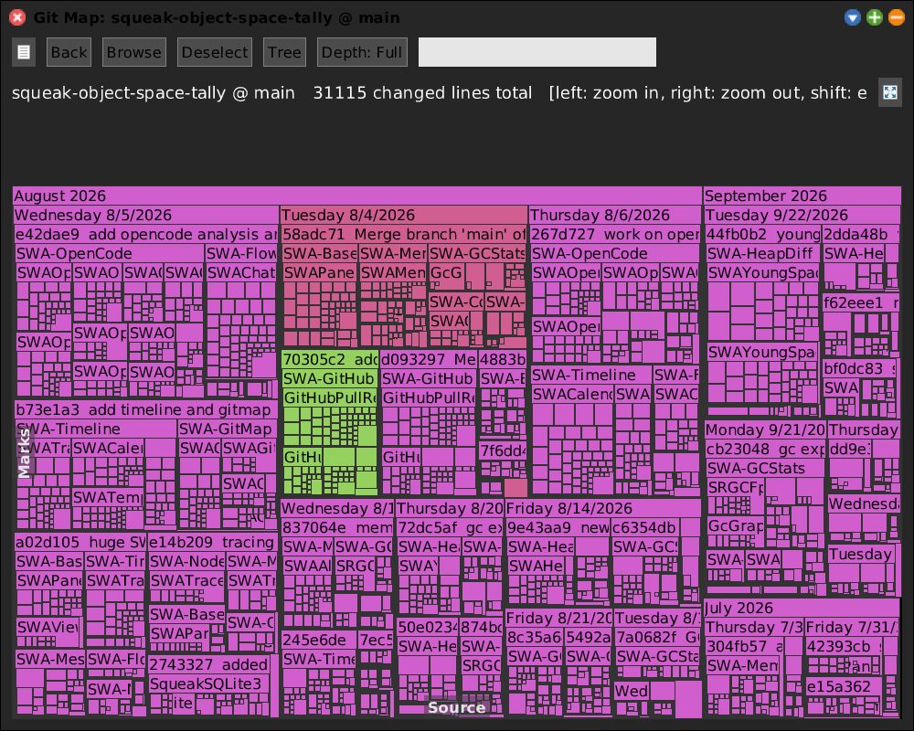
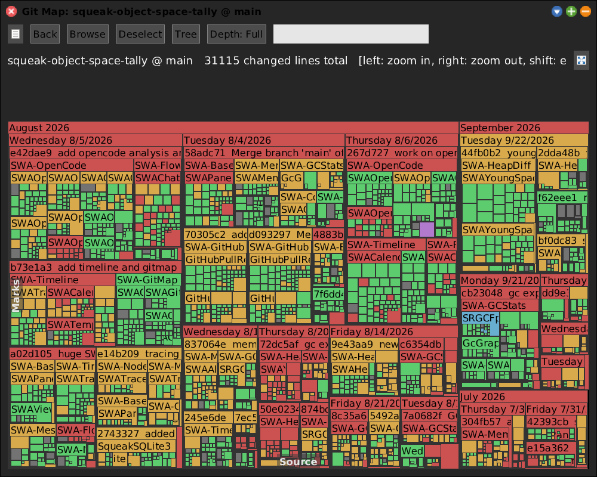

# Git Map

[Gallery index](index.md) · referent **code** · extent **series** · **Look**

> What did these *commits* change, and what is churning?

The Change Map's picture drawn from a **GitS repository** instead of the
`.changes` file: `month -> day -> commit -> package -> class -> method`, tile
weight = diff lines. Subclasses the Change Map
(`SWAGitTreemapMorph` is a `SWAChangeTreemapMorph`).

Full doc: **[SWAGitMap.md](../SWAGitMap.md)**.

**Open:** `SWA Code: Git Map`, or `SWAGitHistory open`.

<!-- SCREENSHOT gitmap-by-commit.png -- needs a fixture: a GitS repository loaded in the image
| w |
w := SWAGitHistory open.
World displayWorld. (Delay forMilliseconds: 2000) wait. World displayWorld. (Delay forMilliseconds: 500) wait.
PNGReadWriter putForm: w imageForm onFileNamed: 'squeak-object-space-tally/doc/media/gitmap-by-commit.png'.
w delete.
-->

## The second half: churn as a Code Map dataset

The more useful half is not the treemap. `SWAGitChurnData` folds the same history
**per method** and loads into a Code Map as a dataset, so git history becomes a
colour axis on the structural map:

| Metric | Answers |
|---|---|
| commits | how often has this method been touched? |
| changed lines | how much has moved through it? |
| recency | when was it last touched? |
| authors | how many hands? |

That projection is the join working as designed: `crossRefKey` is
`'Class>>selector'` in both tools, so no translation layer is needed.

## Colour modes

*By author* -- who committed each tile, across 60 commits.

*By status vs image* -- whether each committed method **still exists**. The
superseded and gone tiles are history that the current image no longer contains.

## Git Map or commit range?

The two git tools answer different questions. The Git Map is **history as a
series**: every commit a tile, churn accumulated across them. A
[commit range](git-range.md) in any code view is **one diff**, base against head:
the net effect of a pull request, built from the two snapshots, with deleted code
still in the picture and review sign-offs on it. Use the range to review; use the
Git Map or the churn dataset to find where the work keeps going.

Both depend on the GitS API. When GitS renamed `changeSetsFromCommit:toCommit:`
to `changesFromCommit:toCommit:`, `codeChangesForCommit:` swallowed the error and
answered `#()`, so the map was probably **silently empty** for every repository
until it was repaired on 2026-10-21
([journal](../../../journal/2026-10-21c-cleaning-up-for-the-merge-and-a-diagram-that-shows-the-diff.md)).

## What it cannot see

Only what was **committed**. Work that was written and reverted, or never
committed, is invisible here and visible in the [Change Map](change-map.md). Work
the agent merely *read* is invisible in both, and visible in
[OpenCode Sessions](opencode.md).
