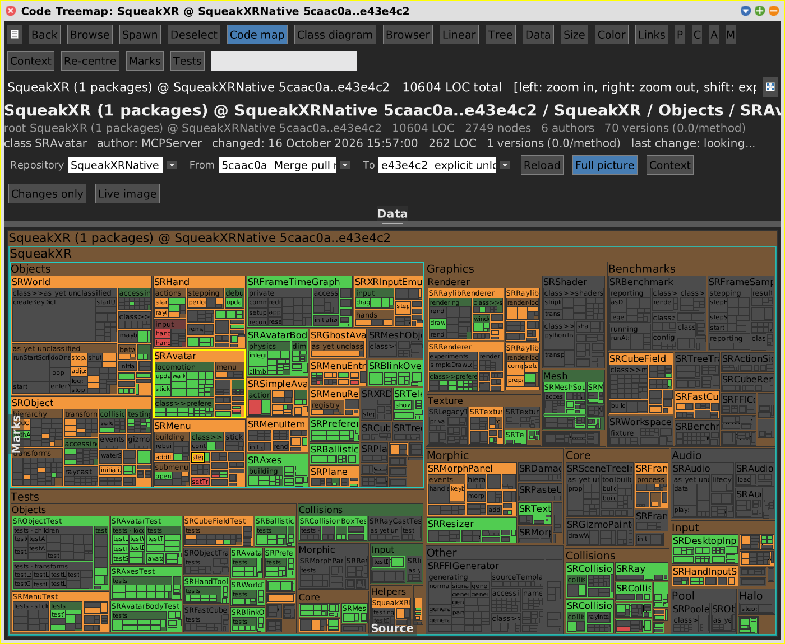

# Commit range (Git Data)

[Gallery index](index.md) · **shared aspect** of the four code views: Code Map,
Class Diagram, Browser, Linear

> What did this range of commits change -- seen in place, or on its own?

Any code view can be put on a **range of commits** of a GitS repository. The range
is chosen in the **Data** flap and kept on `SWAView`, so it survives every switch
between the views. It is the code side of reviewing a pull request; the
[Git Map](git-map.md) is the other git tool and answers a different question
(history as a time series, churn as a dataset).

Journals: [2026-10-21c](../../../journal/2026-10-21c-cleaning-up-for-the-merge-and-a-diagram-that-shows-the-diff.md)
(the first range diagram),
[2026-10-23b](../../../journal/2026-10-23b-the-code-map-learns-history-and-an-idea-for-xr.md)
(built from git, any branch, moved up into `SWAView`).

**Open:** the **Data** flap of a code pane, or `SWA Code: Class Diagram (commit
range)`, which asks for a repository and opens `PARENT..HEAD` -- the newest commit
alone -- with the flap already out. From code:
`SWAClassDiagram openOnGitRepository: 'SqueakXRNative' from: '5caac0a' to: 'e43e4c2'`.

<!-- SCREENSHOT codemap-range-full.png -- off-screen, see index.md "Screenshot recipes"
view setRepository: 'SqueakXRNative' from: '5caac0a' to: 'e43e4c2'.
view loadGitRange.
"...pane + window, 1400@1150..."
pane openData.
view selectedNode: (view keyIndex at: 'SRAvatar').
-->

## The fields

| Field | Takes |
|---|---|
| **Repository** | a GitS working copy |
| **From** | a hash prefix, a branch, or **PARENT** -- the first parent of the To end, which makes stepping To down the log show one commit at a time |
| **To** | **HEAD** (the default, follows the branch), **CURRENT**, a branch, `origin/<branch>`, or a hash prefix |
| **Reload** | re-reads both ends |

**CURRENT** is the image itself, uncommitted changes included: `PARENT..CURRENT`
is "what I have not committed yet". It stays a keyword rather than a hash, because
the image commit is rewritten on every change; the parent of CURRENT is the head
commit.

Branch names mean **the image's** branches (GitS keeps them under
`refs/squeak/<image>/heads/`, not `refs/heads/`, which belongs to whatever
command-line checkout ran last). Names resolve to hashes before they reach the
review scope, so a sign-off names commits, not moving refs. A hash prefix is found
in ~2 ms from the loose-object directory and the pack index fan-out, on any branch.

An end that does not resolve is **reported**, and the fields fall back to the last
range that loaded: the fields must describe the picture on screen.

## Four ways to show it

| Button | Shows |
|---|---|
| **Full picture** | the whole tree, built from the To end, changed members coloured |
| **[Context](context.md)** | only the changes and what directly reaches them or they reach |
| **Changes only** | only what changed; in the Code Map tiles are sized by what changed in them |
| **Live image** | the image as it is, the range ignored (and the source editable) |

Colours are the same in every view: **green** added, **orange** modified, **red**
removed (struck out in lists and diagram rows). A container rolls up the strongest
kind below it.

## Built from git, not from the image

A range is shown as the code was **then**. `SWACodeSnapshot` (category
`SWA-GitRange`) loads both ends as Monticello snapshots via GitS and merges them
into stand-ins (`SWASnapshotPackage`, `...Class`, `...Metaclass`, `...Method`,
`...Organizer`) that answer the part of the Behavior protocol the code nodes use. So
the same node classes build every view, and **deleted classes and methods are real
tiles and rows** -- a deleted method's diff is all removed lines.

It is one diff of base against head, the **net effect**: a method changed and
reverted inside the range does not count.

## Limits

- Extension methods of classes outside the loaded packages are not in a snapshot
  (`Vector3 class>>forward` on the PR range).
- The *versions* colour has nothing for git-built members.
- A range diagram with many changes takes 5-11 s, mostly Graphviz, which blocks the
  image while it runs.
- Source is editable only in **Live image** ([source.md](source.md)).
