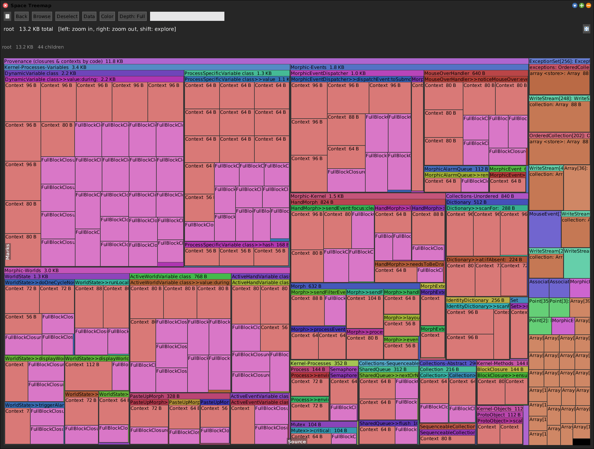
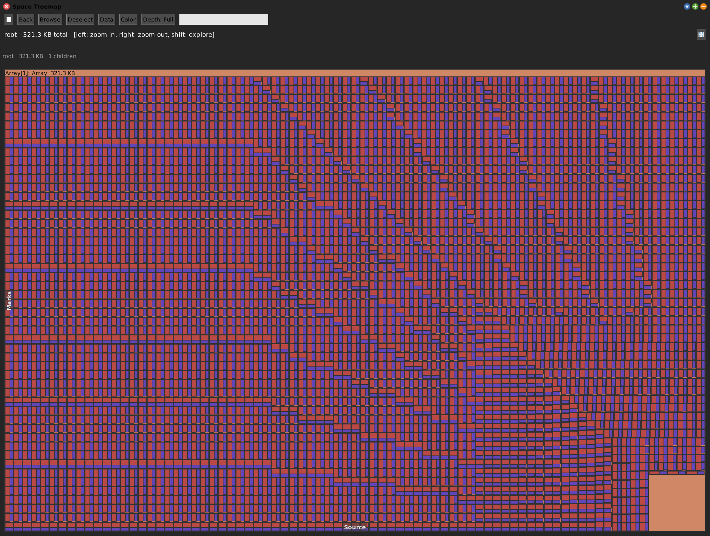

# Heap Diff


[Gallery index](index.md) · referent **object** · extent **instant** · **Snap**

> What did *one action* allocate?

Snapshots the whole heap twice with `SystemNavigation allObjectsOrNil` -- a flat
`O(heap)` sweep, not the Space Tally graph walk -- and reports what is new in the
second snapshot, as an enriched treemap with a **Provenance** branch grouping
closures and Contexts by their home method.

Journal: [2026-08-14](../../../journal/2026-08-14-heap-diff-and-per-frame-allocation-provenance.md).

**Open:** `SWA Object: Heap Diff (1 Morphic step)`, or
`(SWAHeapDiff around: [ anAction ]) openEnrichedTreemapWithProgress`.



<!-- SCREENSHOT gallery-heapdiff.png -- must run in the UI process (a menu action does)
| w |
w := SWAHeapDiff openMorphicStepTreemap.
World displayWorld. (Delay forMilliseconds: 1500) wait. World displayWorld. (Delay forMilliseconds: 500) wait.
PNGReadWriter putForm: w imageForm onFileNamed: 'squeak-object-space-tally/doc/media/gallery-heapdiff.png'.
w delete.
-->

## Why two phases

Capturing a snapshot is just the raw sweep (~50 ms), so `captureBaseline` and
`captureAfter` can run back-to-back **inside a single frame**. All the expensive
work -- building an identity set of the first snapshot and probing the second
against it -- is deferred to `diff`, off the hot path, on two already-frozen
arrays.

**No GC happens between the two sweeps**, on purpose: a collect would drop exactly
the short-lived objects you may want to see. So garbage is included, by design.

## Noise floor

The diff excludes its own scaffolding by identity, but genuine transient churn in
a live image -- the XR render loop, the MCP server servicing the call -- still
shows up. Expect **~1500--2300 objects even when "nothing" happens**.

## Survivor Diff -- one line different, and not in the menu

`SWASurvivorDiff` runs `garbageCollectMost` *between* the action and the
after-snapshot, so the result is what **survived** a scavenge rather than what was
allocated. Because these are real objects (not hash fingerprints), the inherited
provenance enrichment applies unchanged: it names the *code* keeping them
reachable.

It was **removed from the Apps menu** on 2026-09-22. Measured on an idle desktop:

| | new objects |
|---|---:|
| Heap Diff, 1 Morphic step | 752 |
| Survivor Diff, 1 Morphic step | 13 |

A treemap of 13 objects reads as a broken tool. It is not broken -- it needs a step
that actually retains something:

```smalltalk
SWASurvivorDiff around: [ theWorkYouCareAbout ].
SWASurvivorDiff measureXRFrames: 10 in: SRWorld current.
```

or the XR menu (**profile > survivors > 1 / 10 / 100 frames**), where a render
frame retains thousands. A Morphic game doing real work in its step qualifies too.

## Survivor Diff, pictured



`SWASurvivorDiff around: [...]` over a block that allocates 4000 three-element
arrays and **keeps them**: 12,001 surviving objects, grouped by the home method
that made them. Compare with the idle Morphic step's 13 -- the tool is only as
interesting as the step you give it.

## Versus Young Space

Both end in the same enriched treemap with the same provenance branch, and both
are about young objects. They differ in what bounds the set:

> A **diff** is bounded by an *action you supply*. **Young space** is bounded by
> the *collector*.

Young space has a standing floor that no single step created, and that floor is
invisible to a diff. Use the diff when you have one action to blame; use
[Young Space](young-space.md) when you do not.
