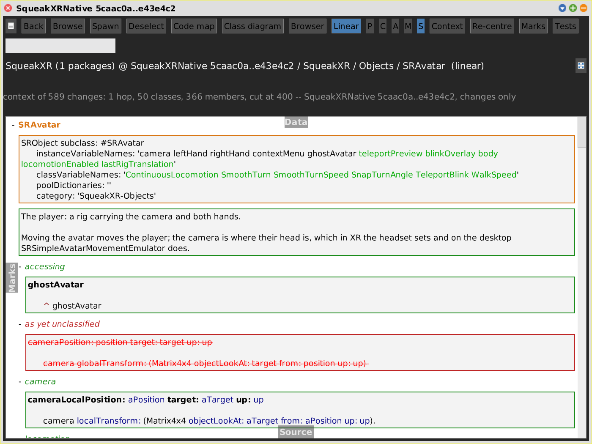
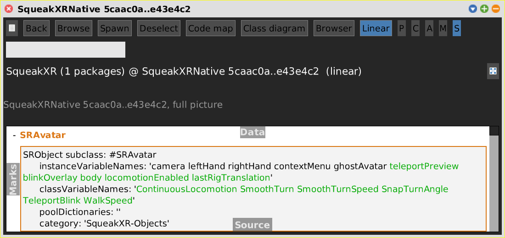

# Linear

[Gallery index](index.md) · referent **code** · extent **timeless** (or a commit range) · **Look**

> Can I read this as one document -- and on a range, review it top to bottom?

The fourth view of the code pane (`SWACodeLinearView`, rows in `SWALinearCodeMorph`):
the same tree as an outline. A row per package, class and category, `+` / `-` to
expand, and at depth **S** the class definition, the comment and every method's
source inline. On a range each member shows its **diff**, framed in its change
colour, so *Changes only* turns it into a review document of the range.

Journal: [2026-10-23c](../../../journal/2026-10-23c-a-system-browser-inside-the-code-pane.md)
("Linear: the code as one document").

**Open:** the **Linear** button of any code pane.

<!-- SCREENSHOT linear-range-changes.png -- as browser-range-changes.png, then:
view zoomInto: (view keyIndex at: 'SRAvatar').
pane switchToCodeView: #linear.
win fullBounds. pane view step. win fullBounds.
The `step` matters: the view only fits its rows to the scroll pane's width when it
steps, and off-screen nothing steps, so without it every row is a few words wide.
-->

## Depths

The depth buttons are **P C A M S** -- package, class, c**A**tegory, method, and
**S**ource, the one that inlines the code. The letters are derived
(`SWAPane>>depthLetters`): each depth takes its first letter not already used.

## What is particular to it

- **Each member is its own text.** The rows are `TextMorph`s, not
  `PluggableTextMorph`s, so there is no inner scroll pane to swallow the mouse wheel,
  and each grows to fit its text. **Cmd+S** in a member saves that member (live
  image only, see [source.md](source.md)).
- **Word diffs for definitions and comments** (`ClassDiffBuilder`): in the shot,
  `SRAvatar`'s definition shows only the five new instance variables and six class
  variables in green, not the whole line struck and re-added. Methods keep the line
  diff. This applies to every view's Source flap, not only here.
- In Changes only, a class definition is shown only when the range added, modified
  or removed it (`showsDefinitionOf:`).
- A menu on each header row: zoom into, browse, sign off.
- Expansion is remembered by `pathString`, so it survives the switch between the
  live tree and the git-built one.
- Rows are built into a detached morph and swapped in at the end: the whole SqueakXR
  package at **S** (2769 rows) takes 1.2 s rather than 9.6 s.

Shares: [commit range](git-range.md), [reviews](reviews.md),
[context](context.md) (filters the rows), [linked views](linked-views.md).
Not yet: [marks](marks.md), *Focus marked*, and an unsaved-edit prompt for the
code rows.
