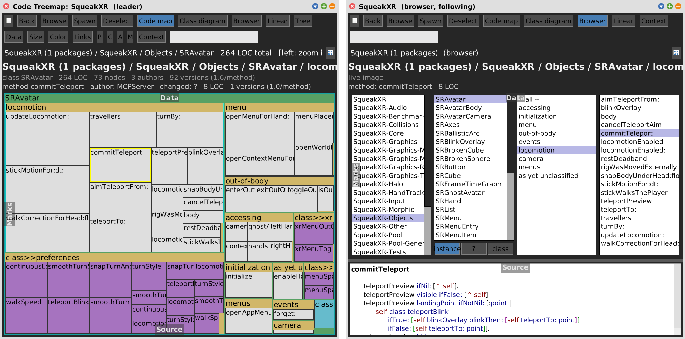
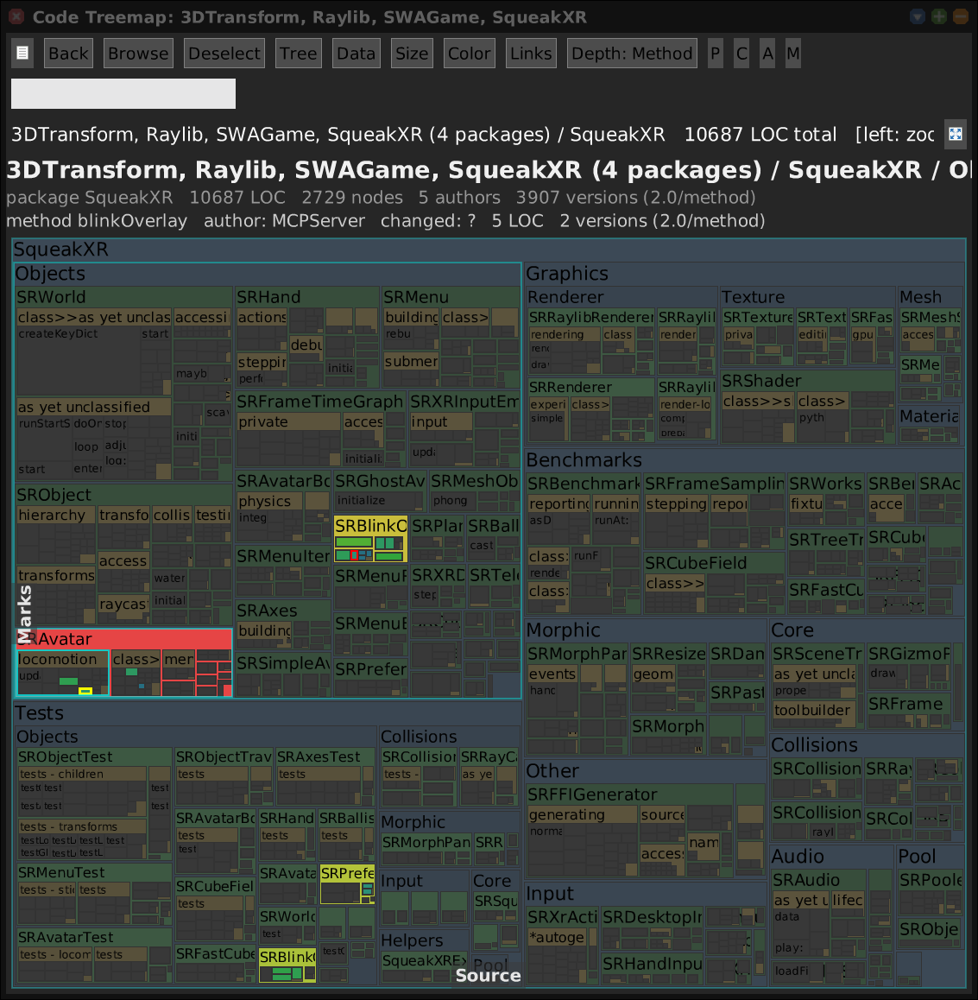
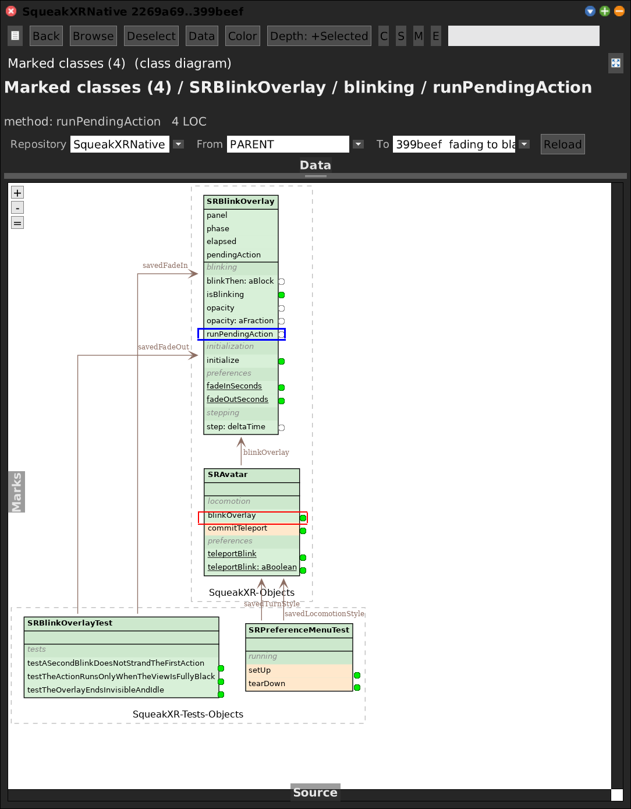

# Linked views

[Gallery index](index.md) · **shared aspect**: one pane with four code views,
panes that follow each other, and views that colour each other

> Can I look at the same thing two ways at once, without setting it up twice?

Three mechanisms, from tightest to loosest.

## 1. One pane, four views

Every code pane has the buttons **Code map | Class diagram | Browser | Linear**
(`SWAPane>>codeViewSpecs`). They switch the pane in place. Both views are kept, and
the incoming one **takes over** (`SWAView>>takeOverFrom:`):

| Carried over | Note |
|---|---|
| root and [commit range](git-range.md) | the git-built tree is **shared**, not rebuilt, when both views show the same snapshot |
| Full picture / Context / Changes only / Live image | |
| review scope | |
| datasets | same mode symbols, so a colour layer carries over |
| selection | |
| zoom | as a name (`#category -> 'SqueakXR-Objects'`, `#class -> 'SRAvatar'`), so it works between the live tree and a git-built one: a map zoomed into a package becomes a diagram of that category |
| [context](context.md) | the costly range context is shared, not recomputed |
| Focus marked | |

Not carried: the depth (each view has its own: map **P C A M**, diagram
**C S M E**, linear **P C A M S**).

## 2. Spawn and Follow

**Spawn** (header) opens a second pane on the same tree, range and datasets, as the
same view, linked to the pane it came from, with a **Follow** toggle.

<!-- SCREENSHOT spawn-follow.png -- two off-screen windows composited side by side.
Following needs both panes in a world (followLeader checks `leaderPane world`), so
off-screen the follow step is done by hand:
nv := pane newCodeView: #browser. nv extent: view extent. nv takeOverFrom: view.
pane wireOverlayFor: nv. pane2 := SWAPane on: nv. pane2 followPane: pane.
view zoomInto: (view keyIndex at: 'SRAvatar').
view selectedNode: (view keyIndex at: 'SRAvatar>>commitTeleport').
nv selectNodeForKey: 'SRAvatar>>commitTeleport'. pane2 openSource.
both := Form extent: ... f1 displayOn: both at: 0@0. f2 displayOn: both at: (f1 width + 20)@0.
-->

- Following is **one-way**: the follower takes over the leader's range, its mode
  where both views have one, its zoom and its selection. Chains work: A -> B -> C.
- Only **changes** at the leader count, so a follower clicked elsewhere stays there
  until the leader moves.
- The follower's own selection shows in the leader as the red secondary selection.
- The hook is `SWAPane>>refresh`, which every view calls after selection and zoom.

## 3. Cross-reference: colour one view by another

Every open treemap, flamegraph or diagram appears in the **Data** menu of the others
as *"X-ref: `<window>`"*. Picking it adds a `#peer` dataset that reads the other
view's weights **live** -- no file, no export.

- **It updates.** When the source view rebuilds its key index it re-derives the
  dependent's colour scale, renames the dataset to its current window label and
  flushes the dependent's pixels.
- **The peer answers for what it draws**, not for what it holds. A class diagram
  keeps every member of a touched class as context but draws only what its depth
  allows; colouring by the hidden members lit whole classes.
- **A container with its own value is data**, not context: a class the dataset names
  directly lights up, even when container tinting is off.
- **Selection travels both ways**, as the red secondary selection, even though data
  flows one way.

The links are explicit and **weak**: a `WeakSet` of dependents, registered in
`addDataset:` and dropped in `removeDataset:` / `SWAPane>>delete`. Caching the
linked views would have been a strong reference -- an image that never forgets is
an image that grows. Selection propagation went from a 25 ms heap scan to 0 ms.

Journal: [2026-10-22](../../../journal/2026-10-22-treemap-legibility-and-the-cross-reference-that-pushes-back.md).
The non-code tools take part in this third mechanism too; the peer x-ref of an
allocation flamegraph is on the [Code Map](code-map.md#datasets-pictured) page.
