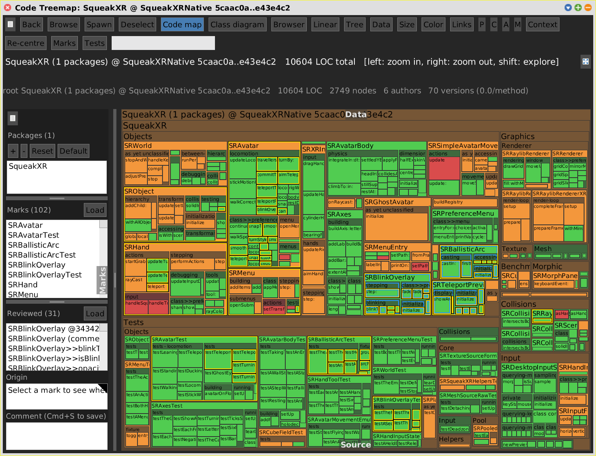
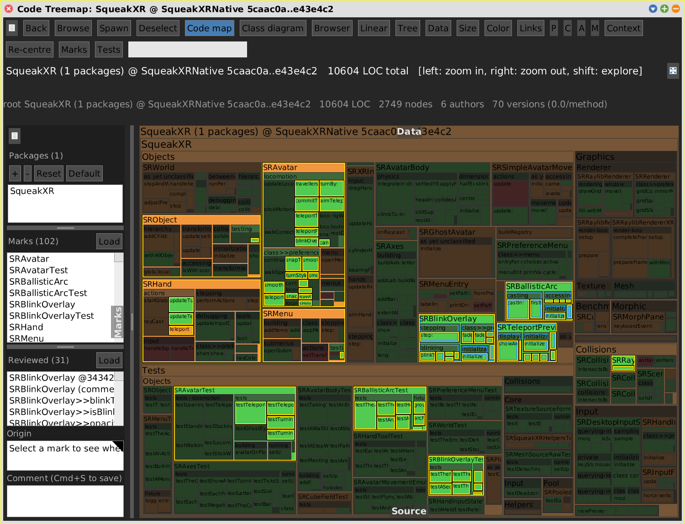

# Marks

[Gallery index](index.md) · **shared aspect** of every SWA view; drawn by the
treemaps, used by the Class Diagram and the context

> Which places have I picked out, and why -- across all the tools at once?

A mark is a bookmark on a `crossRefKey` (`'SRAvatar'`, `'SRAvatar>>turnBy:'`,
`'SRAvatar>>#blinkOverlay'` for an instance variable). Marks live in one global
set, `SWAMarkSet default`, so marking a method in a flamegraph lights it in every
open Code Map. Each mark can carry a **comment** and records its **provenance**:
which kind of view it was made in, the dataset that was active, and the scope --
enough to re-open that view later.

Journals: [2026-07-16](../../../journal/2026-07-16-marks-multiselect-and-ctrl-click-event-hell.md),
[2026-07-17](../../../journal/2026-07-17-marks-burger-menus-flap-tab-and-setview-refactor.md),
[2026-07-17b](../../../journal/2026-07-17b-mark-provenance-and-show-in-view.md),
[2026-10-26](../../../journal/2026-10-26-review-deck-and-screenshots-from-the-running-world.md)
(the flap rework, Focus marked).

**Mark:** shift+click a tile, or **Mark / Unmark** in the tile menu. The timeline,
calendar, trace and chat-flow views mark the same way.

<!-- SCREENSHOT marks-reviews-changes-only.png -- swap in empty sets (never touch Jens' marks):
savedD := SWAMarkSet classPool at: #Default. savedR := SWAMarkSet classPool at: #Reviewed.
[SWAMarkSet classPool at: #Default put: SWAMarkSet new. SWAMarkSet classPool at: #Reviewed put: SWAMarkSet new.
 SWAMarkSet default loadFromFile: 'notes/squeakxr/marks/04-teleport-turn-blink.json'.
 ...range 5caac0a..e43e4c2, rangeView: #changes...
 #('SRBlinkOverlay' 'SRBallisticArc' 'SRTeleportPreview') do: [:k | view toggleReviewedAllUnder: (view keyIndex at: k)].
 ...pane + window 1500@1150... pane openMarks. ...shoot...
 view toggleFocusMarked. ...shoot marks-focus-marked.png...]
 ensure: [SWAMarkSet classPool at: #Default put: savedD. SWAMarkSet classPool at: #Reviewed put: savedR.
   SWAMarkSet default notifyPanes].
-->

## The flap

Top to bottom: the burger menu, the [Packages list](view-layer.md#the-packages-list),
**Marks (n)** with **Load**, the marks list, a splitter, **Reviewed (n)** with
**Load** -- the [sign-offs](reviews.md), a set of their own -- then **Origin**
(the provenance of the selected row) and **Comment** (Cmd+S to save).

- Both lists share one selection logic: shift extends, ctrl toggles; selecting in
  one clears the other's primary row; comments and removal act on the set that owns
  the row.
- Clicking a row reveals the mark in the view (`SWAPane class>>showMarkKey:`); a
  mark whose view is gone can be re-opened from its provenance.
- Load and Save remember their directory (`SWAPane MarksDirectory`).
- Mark sets are plain JSON (`keys`, `comments`, `provenance`). The review deck for
  the XR branch has one per feature in `notes/squeakxr/marks/`.

## How each view uses them

| View | Marks show as |
|---|---|
| Code Map, other treemaps | a **yellow frame with a black outline** on the outer three pixels (`SWASelectionPainter>>markFrameOn:rect:`); yellow is the one colour no other frame uses |
| Code Map | **Focus marked** (burger menu, tile menu) dims everything not marked |
| Class Diagram | depth **E** (`#selected`) draws only the **marked** ivars and methods of each class; `SWAClassDiagram openOnMarks` diagrams the marked classes and rebuilds when the marks change |
| any code view | the **Marks** button of the [context](context.md) centres it on every marked place at once |
| Browser, Linear | not shown yet |

## Focus marked

Focus is one more layer in `SWAView>>colorForNode:`, after the search dimming, so
whatever colour mode is on stays readable. What stays bright: marked nodes, their
ancestors, and all members of a marked node -- **unless one of its members is
marked itself**. The most specific marks win: a feature's mark set marks both
`SRObject` and one method of it, and without the rule the whole class would light
up (1 method bright, 160 siblings dimmed). The flag travels with a view switch but
only the Code Map dims so far.

## Testing without touching the user's marks

`Default` and `Reviewed` are class variables. `SWAMarksPanelTest` and
`SWAFocusMarkedTest` swap in fresh sets and restore them in `tearDown`; the
screenshot recipes above do the same in an `ensure:`.
