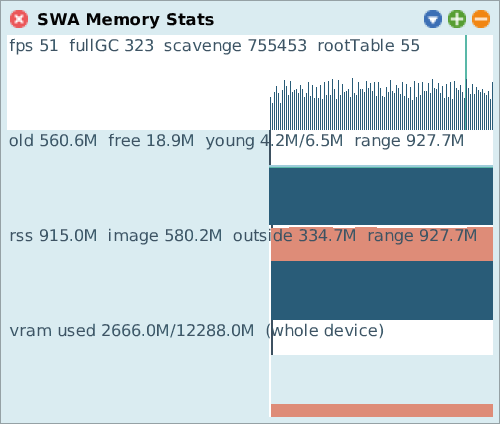

# Memory Stats

[Gallery index](index.md) · referent **OS process** · extent **series** · **Look**

> What is the whole *process* doing -- outside the object memory?

A live graph of the whole OS process: object memory, **FFI and native memory**,
GPU uploads and **VRAM**. The only tool that looks outside the image at all.

Journal: [2026-07-30c](../../../journal/2026-07-30c-memory-outside-the-image-proc-nvml-gpu-tally.md).

**Open:** `SWA Process: Memory Stats`, or `SWAMemoryGraphMorph open`.

<!-- SCREENSHOT gallery-memorystats.png -- let it run a few seconds so the lanes have data
| w |
w := SWAMemoryGraphMorph open.
World displayWorld. (Delay forMilliseconds: 4000) wait. World displayWorld. (Delay forMilliseconds: 500) wait.
PNGReadWriter putForm: w imageForm onFileNamed: 'squeak-object-space-tally/doc/media/gallery-memorystats.png'.
w delete.
-->

## Why it exists

Every other tool in the suite measures **object memory**. For an XR image that is
a minority of the footprint: meshes, textures, shaders and FFI structures live in
native memory and on the GPU, where `Smalltalk vmParameterAt:` cannot see them and
a heap walk cannot reach them.

Sources are correspondingly outside the image: `/proc` for process RSS, NVML for
VRAM, and the renderer's own upload accounting for what Squeak put there.

## Reading it against the others

Like [GC Stats](gc-stats.md), it has **no `crossRefKey`** -- there is nothing to
attach a per-class result to. Both are joined to the rest of the suite by shared
**clock** only.

The pairing that pays: a native-memory step with no corresponding object-memory
step means something was allocated through FFI and is *not* owned by any Smalltalk
object the [Space Tally](space-tally.md) can charge it to. That is the gap the
landscape calls `external/interval` -- nothing in the suite times an individual
FFI, GL, file or socket call, so a step here can be seen but not attributed.
