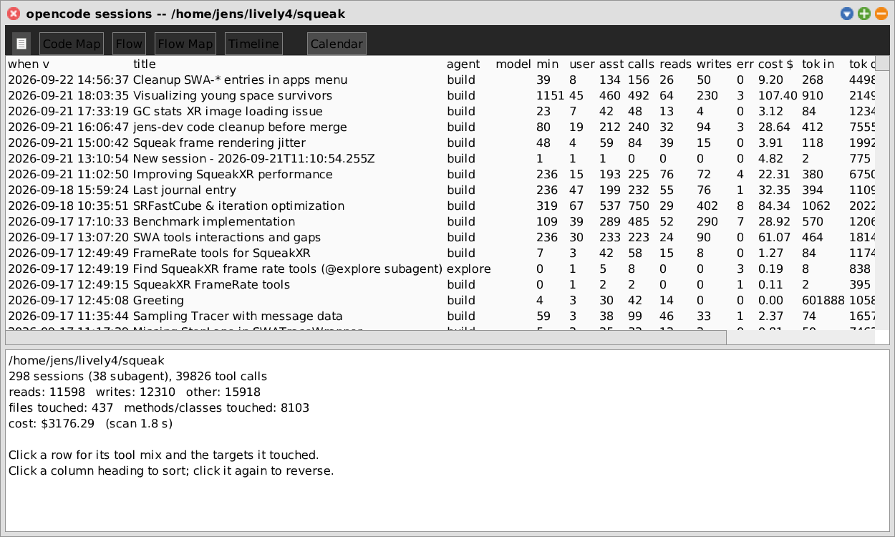
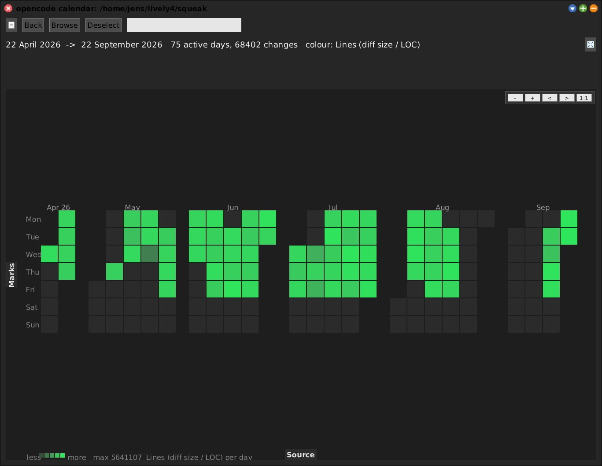
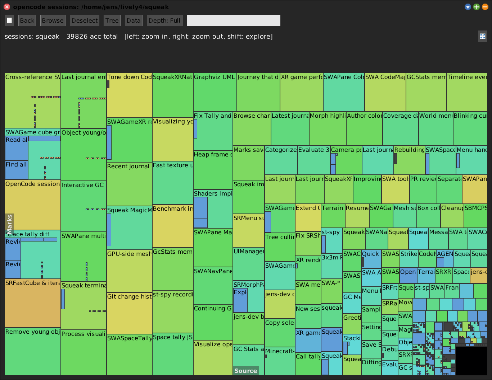
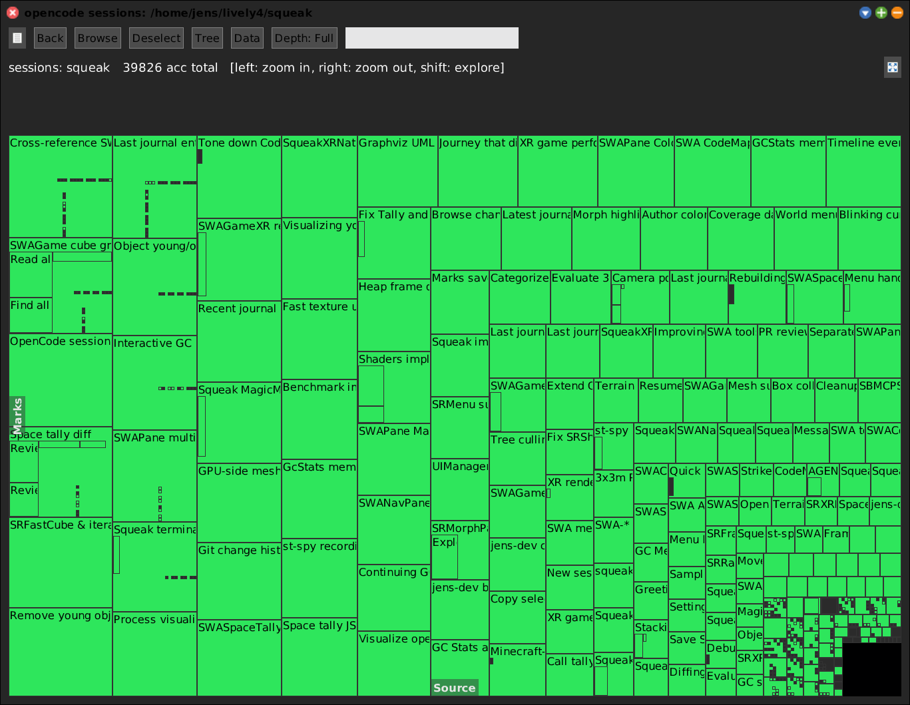
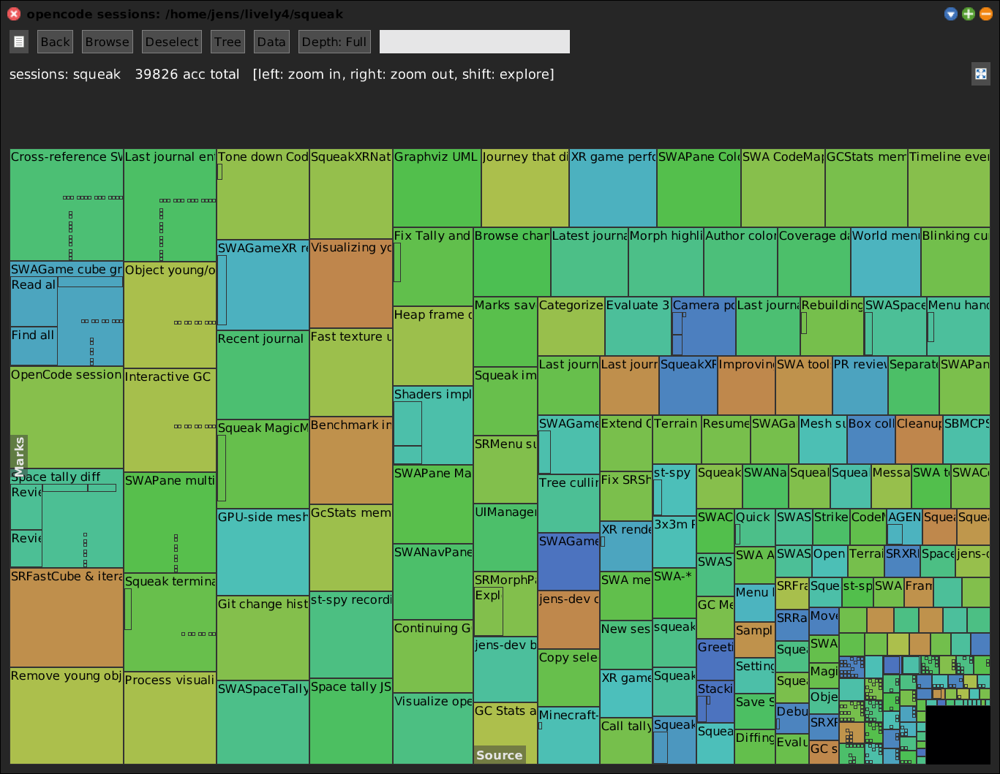
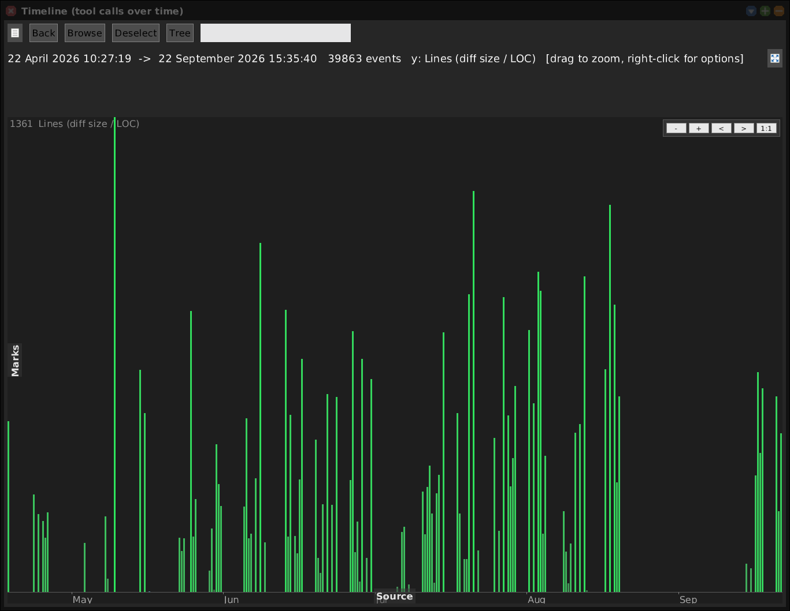
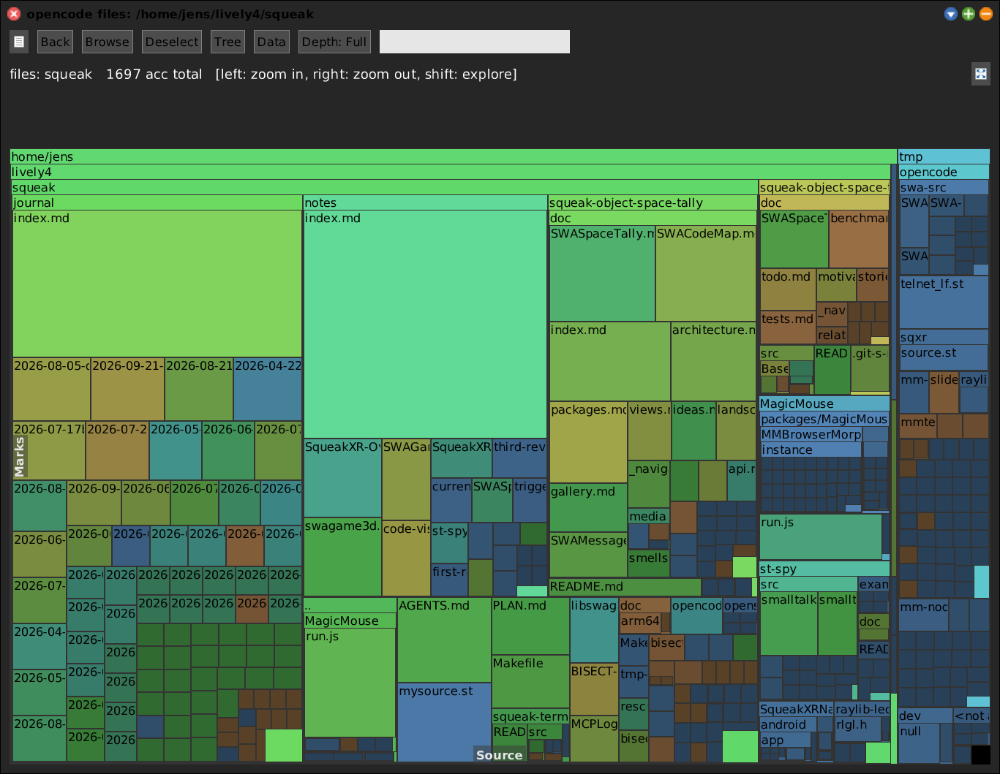
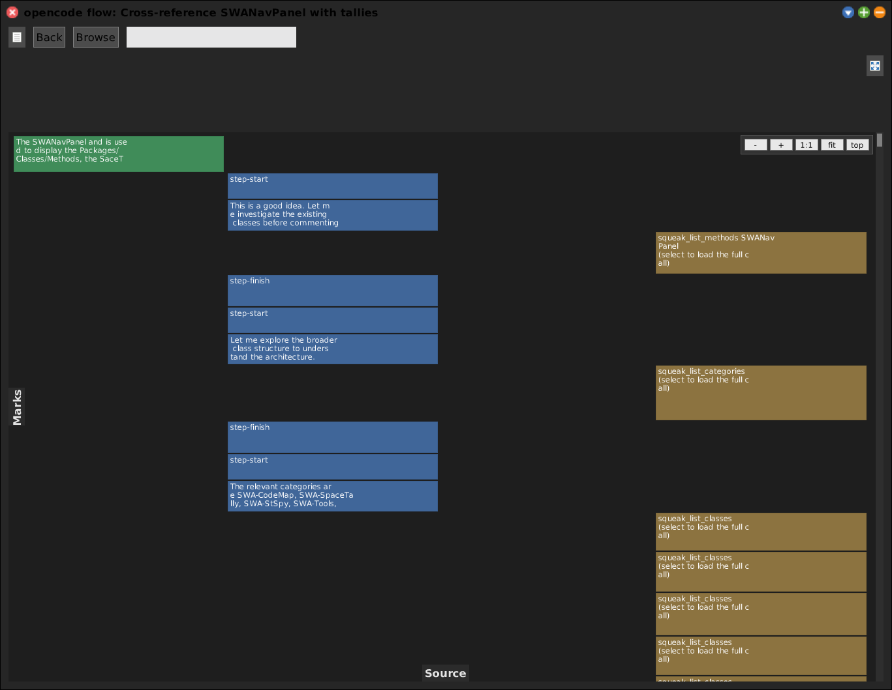
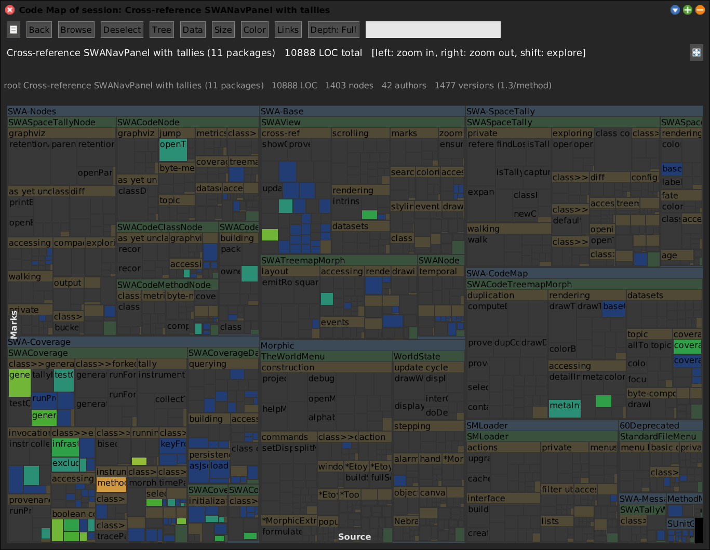

# OpenCode Sessions

[Gallery index](index.md) · referent **code** · extent **series** · **Look**

> What did the *agent* look at -- as opposed to commit?

Reads opencode's own SQLite store and projects an agent's work onto the code:
sessions, tool calls, files and methods **read** versus **written**, cost and
token counts, over time.

Journal: [2026-08-05](../../../journal/2026-08-05-opencode-sessions-in-swa-and-two-sqlite-bugs.md).

**Open:** `SWA Code: OpenCode Sessions`, or `SWAOpenCodeHistory openSessionTable`.

<!-- SCREENSHOT gallery-opencode-sessions.png -- first open rescans the store (~30 s on a 1.8 GB db)
| w |
w := SWAOpenCodeHistory openSessionTable.
World displayWorld. (Delay forMilliseconds: 1500) wait. World displayWorld. (Delay forMilliseconds: 500) wait.
PNGReadWriter putForm: w imageForm onFileNamed: 'squeak-object-space-tally/doc/media/gallery-opencode-sessions.png'.
w delete.
-->

## Views

One history, several views, all from the session table or directly:

| View | Send |
|---|---|
| session table (sortable, CSV export) | `openSessionTable` |
| session treemap | `openSessionTreemap` |
| file treemap | `openFileTreemap` |
| timeline | `openTimeline` |
| calendar | `openCalendar` |
| flow (zoomable conversation) | `openFlow` |
| Code Map of one session | `openCodeMapFor:` |

<!-- SCREENSHOT gallery-opencode-calendar.png
| w |
w := SWAOpenCodeHistory default openCalendar.
World displayWorld. (Delay forMilliseconds: 1200) wait. World displayWorld. (Delay forMilliseconds: 400) wait.
PNGReadWriter putForm: w imageForm onFileNamed: 'squeak-object-space-tally/doc/media/gallery-opencode-calendar.png'.
w delete.
-->

## Colour modes

*Read / write mix* is the default, and the reason the tool exists: **blue =
read-only attention, orange = rewritten**.

*Timeline* -- the same nodes on a time axis, because `SWAOpenCodeNode` answers
`eventTimeStamp` and `eventGroupKey` with no adaptation.

> The `reads` and `writes` colour modes raised `doesNotUnderstand:` on every draw
> until 2026-09-22 -- `intensityColorFor:max:` lived only on `SWATemporalView`.
> Found by trying to screenshot them; now on `SWAView`, where both users inherit it.

## The finding that shaped it

For a Squeak project, **file access is a minority activity**:

| | reads | writes |
|---|---:|---:|
| files (`read` / `edit` / `write`) | 765 | 494 |
| Smalltalk methods & classes (`squeak_*`) | ~7100 | ~6100 |

Because in Squeak **the program is the image, not a directory of text**. And the
keys those tool calls carry are *already* SWA's `crossRefKey` spelling, so the
interesting projection is straight onto the [Code Map](code-map.md) with no
translation. Default colouring is the **read/write mix** -- blue = read-only
attention, orange = rewritten -- because *code an agent read twenty times and
never changed* is exactly where the context budget went, and is invisible to
every other tool.

## Sub-views and the cross-usage

*File treemap* -- the directory tree weighted by access. Small for a Squeak
project, which is the finding above.

*Flow* -- the conversation itself as a zoomable sequence of tool calls.

**Code Map of one session** (`openCodeMapFor:`) is the cross-usage that no other
tool can do: the code *this conversation* touched, lit up on the structural map.
Above is a session of **850 tool calls**. Git would show only what it committed;
this shows what it read.

## Which store, which project

Since 2026-09-22 the default is the **live** store
(`~/.local/share/opencode/opencode.db`), not a frozen copy. Safe to read while
opencode runs *because the store is in WAL mode*, where readers and writers do not
block each other; under SQLite's default rollback journal a full scan would make
opencode's commits fail with `SQLITE_BUSY`. Note that a read-only connection to a
WAL database still **writes** the `-shm` file: read-only is a property of the
handle, not of the files.

- `SWAOpenCodeDb snapshotPath` -- the frozen copy, for reproducible measurements.
- `SWAOpenCodeHistory defaultWorktree` -- a preference (category *SWA*). If the
  store has no such project you are asked to pick one, and your choice is stored.

The scan is cached per worktree; `SWAOpenCodeHistory flushCache` re-reads.
