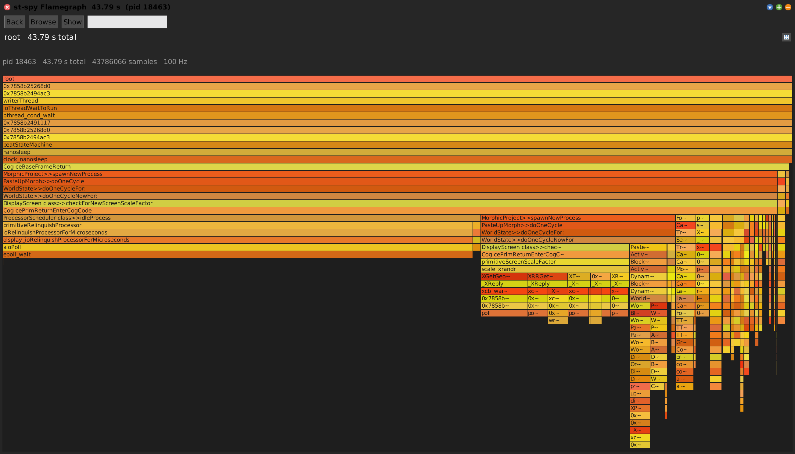

# Sampling Tally

[Gallery index](index.md) · referent **event** · extent **interval** · **Record** (10 s)

> Where does time go across the *whole VM*?

The *statistical* message tally: drives the external **st-spy** sampler over a
running image and presents the wall-clock call tree as a flamegraph (also treemap
and explorer).

Stub doc: **[SWAMessageTally.md](../SWAMessageTally.md)**. Notes:
[st-spy.md](../../../notes/st-spy.md).

**Open:** `SWA Event: Sampling Tally (10s)`, or `SWASamplingTally open` -- which is
`recordSelfFor: 10`, non-blocking, with a progress bar, auto-opening the flamegraph.

<!-- SCREENSHOT gallery-stspy.png -- needs a fixture: an existing chrome-trace file, rather than live recording
| spy w |
spy := SWASamplingTally new.
spy pid: 18463.
spy parseTraceFile: '18463-2026-06-19T13:45:32+02:00.json'.
w := spy openFlamegraph.
World displayWorld. (Delay forMilliseconds: 1200) wait. World displayWorld. (Delay forMilliseconds: 400) wait.
PNGReadWriter putForm: w imageForm onFileNamed: 'squeak-object-space-tally/doc/media/gallery-stspy.png'.
w delete.
-->

Live recording needs the `./st-spy` binary in the VM's working directory.

## What only this one can see

It is an **external process** reading the VM, so it sees what no in-image
instrument can:

- primitives and VM frames,
- time spent outside Smalltalk altogether (FFI, GL, the OS),
- a **wedged image** -- if the image is not running, nothing inside it can profile it.

That is the whole reason to have both samplers. See
[sampling-tracer.md](sampling-tracer.md) for the in-image one.

## Reading it

Frame width is **wall microseconds**, not sample counts, and the flamegraph
formats weights through `formatWeight:` accordingly. Click to select, again to
zoom, **Browse** for the method, **Show** for source.

The tree also loads into a Code Map as a dataset, so *"which methods did the
profiler actually sample, and how hot"* becomes a colour on the structural map --
container tiles roll up their sampled methods, so a class lights up even when only
its methods carry data.

## Exactness

Samplers are approximate and cheap; wrappers are exact and perturbing. The two
diverge on **short methods**, where wrapper overhead dominates the measurement,
and on **cold methods**, which samplers miss entirely. Both project onto the same
key, so the divergence between them is itself observable -- load both as datasets
on one map.
