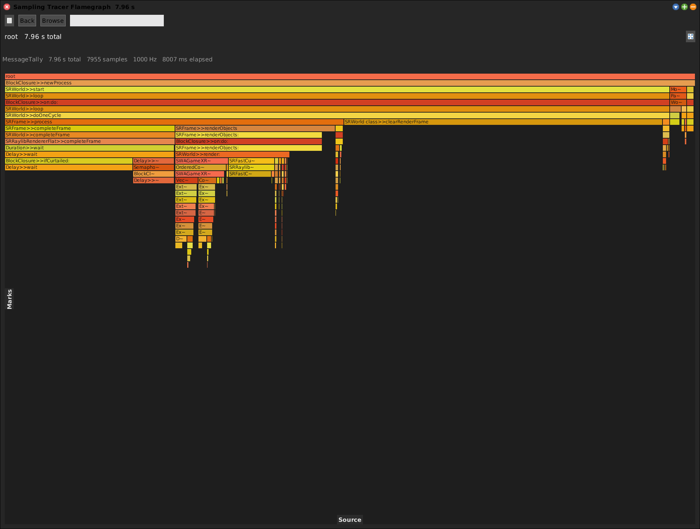
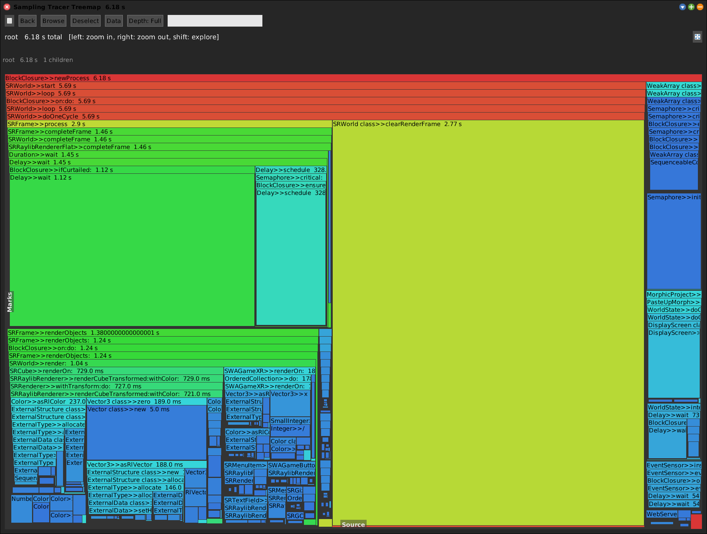

# Sampling Tracer

[Gallery index](index.md) · referent **event** · extent **interval** · **Record** (10 s)

> Where does time go *inside the image*, without instrumenting anything?

The in-image sampler: drives Squeak's own `MessageTally` over a period and
presents the sampled call tree through the SWA flamegraph.

**Open:** `SWA Event: Sampling Tracer (10s)`, or `SWASamplingTracer open` --
`recordSelfFor: 10`.

<!-- SCREENSHOT gallery-sampling-tracer.png -- records this image for 10 s
| w |
w := SWASamplingTracer recordSelfFor: 10.
World displayWorld. (Delay forMilliseconds: 1500) wait. World displayWorld. (Delay forMilliseconds: 500) wait.
PNGReadWriter putForm: w imageForm onFileNamed: 'squeak-object-space-tally/doc/media/gallery-sampling-tracer.png'.
w delete.
-->

## Why both samplers exist

| | Sampling Tracer | [Sampling Tally](sampling-tally.md) |
|---|---|---|
| Mechanism | in-image `MessageTally` | external **st-spy** process |
| Sees primitives / VM frames | no | **yes** |
| Sees a wedged image | no | **yes** |
| Needs a binary on disk | no | yes (`./st-spy`) |
| Perturbs the image | slightly | not at all |

The Tracer is the one that **just works** -- no external binary, no working
directory assumptions. The Tally is the one that can answer questions about the
VM rather than the image.

## The same tree as a treemap

The **Tree** button redraws the sampled call tree as a squarified treemap. A
flamegraph preserves call *depth* on the vertical axis; a treemap spends all the
pixels on relative *cost*. Same data, and the same `crossRefKey`s, so either can
colour a Code Map.

## Why it is not a wrapper

No wrappers means no **eviction** and no **stranding**. The wrapper-based tools
(Coverage, Invocation Tally, Timing Tally, [Trace](trace.md)) install a
`SWAMethodWrapper` per method, which must be uninstalled, can evict under load,
and taxes every send while installed. A sampler has none of those failure modes --
which is why it is the safe default when you do not yet know where to look.

Its cost is the sampler's: it sees only what was running **when it looked**. Cold
methods are invisible, and absence of a datum is ambiguous between *not run*, *not
sampled*, and *too fast to catch*.
