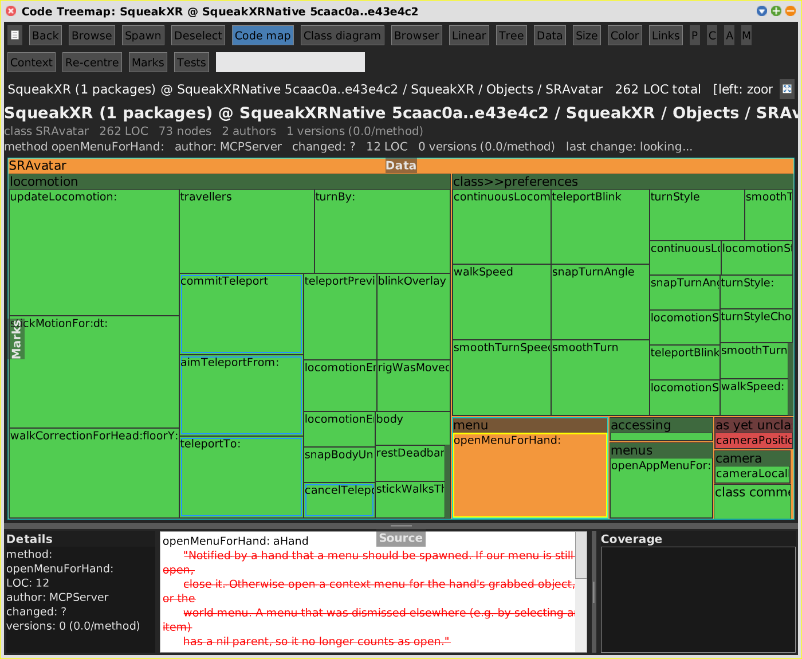

# Source

[Gallery index](index.md) · **shared aspect**: the Source flap of every code view,
and the details pane of every SWA view

> What does the selected thing say -- and on a range, what did it say before?

The **Source** flap at the bottom of a pane holds three panes side by side:
**Details** (kind, LOC, author, last change, versions), the **source** itself, and
a third list that depends on the data loaded -- the covering tests under a coverage
dataset, the duplicate partners under a duplication dataset. In the
[Browser](browser.md) the source pane is the code pane; the Browser opens the flap
on its own.

Journals: [2026-10-21c](../../../journal/2026-10-21c-cleaning-up-for-the-merge-and-a-diagram-that-shows-the-diff.md)
(the diff), [2026-10-23c](../../../journal/2026-10-23c-a-system-browser-inside-the-code-pane.md)
(word diffs, Cmd+S, wrapping).

## What it shows

| Selection | Live image | On a range |
|---|---|---|
| method | its source, Shout-styled | a **line diff** against the From end (`TextDiffBuilder`) |
| class | its definition | the definition, **diffed word by word** (`ClassDiffBuilder`) |
| `?` / comment node | the class comment | the comment, diffed word by word |
| removed member | -- | all removed lines |
| duplicate pair | the inline diff of the two partners | |

The word diff is what makes a class definition legible: only the new instance
variables are green, instead of the whole `instanceVariableNames:` line struck out
and re-added.

The prior source rides along in the Monticello obsoletion of each change, so the
diff costs no extra git access. On a range, Shout styling is switched off for diffs:
Shout and the diff builder both express themselves as `TextColor`, and the last
writer wins.

## Cmd+S saves -- in the live image only

`SWAView>>canEditSourceOf:` lets a save through only when the view does **not**
show a range, the node is a member of the image (not a snapshot stand-in), and the
flap shows exactly that member's text -- which also refuses a description or a
duplicate-pair diff. A refused save says why in the info line and keeps the edit in
the flap.

- A method compiles into its category; a changed selector makes a new method, as
  in the System Browser.
- A class definition is evaluated; a comment is stored. `?` on a class without a
  comment still gets a node, so the first comment can be written.
- After a save the parent's children are rebuilt from the image and every view the
  pane keeps for switching is told (`SWAPane>>codeChangedBy:`), because they share
  the tree.
- **Live image** shows plain source even when a range is loaded, which is how to
  edit while reviewing.
- The Browser asks before list clicks throw away unsaved edits (`okToChange`); clicks
  in the map and the diagram do not ask yet.

The flap's text morph wraps (`wrapFlag: true`). Without it, Shout's bold selector
re-composes into a container shrunk to the plain text's width, and the selector
breaks inside the word -- a Squeak bug that shows in any unwrapped styled pane.
