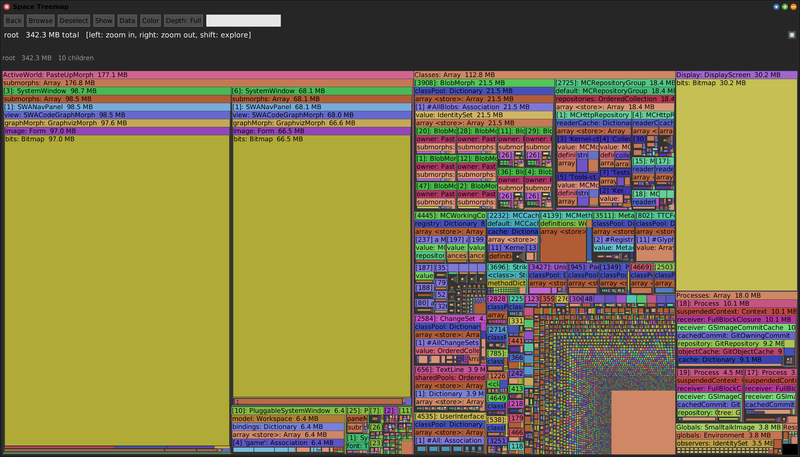
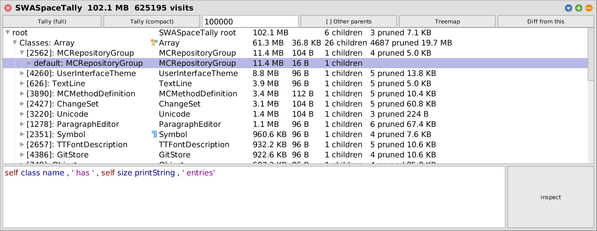
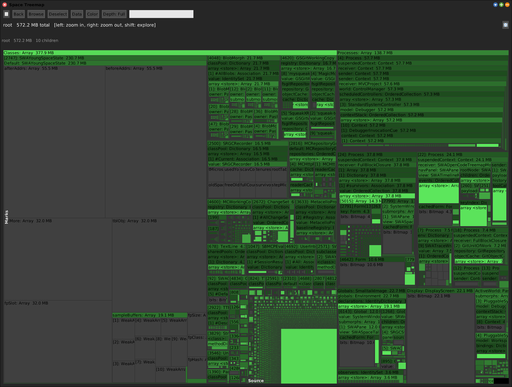
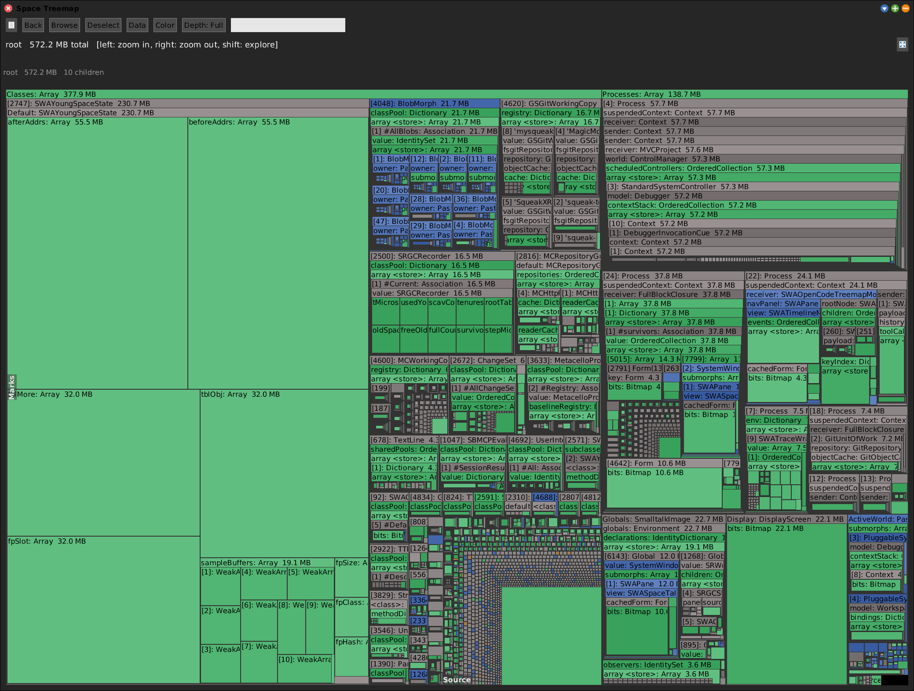
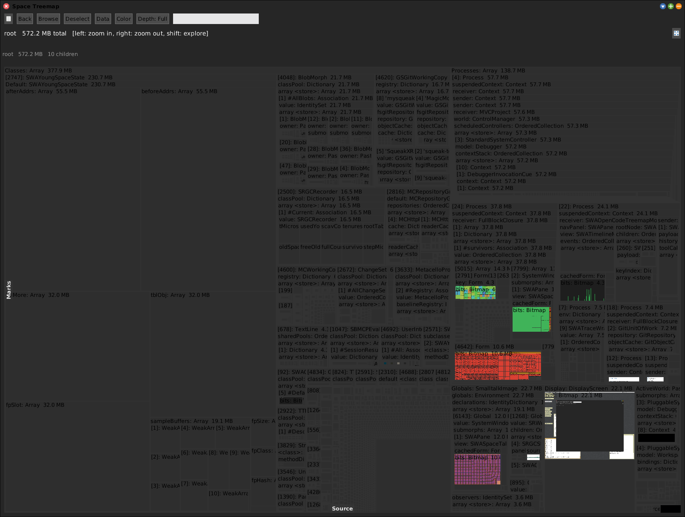

# Space Tally


[Gallery index](index.md) · referent **object** · extent **instant** · **Look**

> Where does the *memory* go, and who keeps it alive?

Walks the **live object graph** (BFS from the roots) and tiles it by retained
bytes. Each object is charged to the **first parent that reaches it**, so the tree
is a containment story rather than a flat census -- which is what makes "who keeps
it alive" answerable.

Full doc: **[SWASpaceTally.md](../SWASpaceTally.md)**.

**Open:** `SWA Object: Space Tally`, or `SWASpaceTally open`.



<!-- SCREENSHOT gallery-spacetally.png -- whole-image walk, tens of seconds at ~500 MB
| w t |
t := SWASpaceTally walk.
w := t openTreemapWithProgress.
World displayWorld. (Delay forMilliseconds: 1500) wait. World displayWorld. (Delay forMilliseconds: 500) wait.
PNGReadWriter putForm: w imageForm onFileNamed: 'squeak-object-space-tally/doc/media/gallery-spacetally.png'.
w delete.
-->

## Two phases, both slow

At ~500 MB and ~2.8 M visits neither phase is quick, so both run under a progress
bar:

1. `Walking heap...` -- the BFS, counting against the universe size.
2. `Space Treemap: laying out...` -- the squarify, done **up front**. Without it
   the bar finishes, the window appears, and the image freezes silently while the
   first draw lays out a few million nodes.

`SWASpaceTally explore` opens the multi-column explorer on the same walk instead
of the treemap.



## Colour modes

The tree is containment; colour is an orthogonal property of each object.



*By number of children* -- the fan-out points, the objects that reach a lot.



*By type* -- Morphic / Collection / Value / Other, which is usually enough to see
whether a region is UI, data, or scalars.



*Bitmap* renders the actual **Forms** into their tiles, so a suspicious block of
retained memory can be identified by simply looking at it.

## Termination

Every walk snapshots a **closed universe** of the heap *before* allocating any
walker state, and only admits objects in it. The universe is finite and the dedup
map claims each object once, so the BFS always terminates -- and none of the
walker's own scaffolding can be mistaken for a tallied object.

## Diffing

```smalltalk
base := SWASpaceTally open.
"... do the thing ..."
SWASpaceTally exploreDiffFrom: base.
```

`open` deliberately does **not** compact. At the default threshold that prunes
nothing and only sets the `[compacted]` marker, so leaving it off keeps the tree
honest for a later `diffFrom:`.

## Relatives, and how to tell them apart

Three tools walk this heap. The distinction is what **bounds** the object set:

| Tool | Object set | Bounded by |
|---|---|---|
| **Space Tally** | everything reachable | nothing -- it is the standing heap |
| [Heap Diff](heap-diff.md) | allocated between two sweeps | an *action you supply* |
| [Young Space](young-space.md) | current young space | the *collector* |

Space Tally says nothing about age or fate. It answers *what is reachable at all*.

> **Known defect.** The **Packages** list appears in this pane but is inert -- this
> view's `crossRefKey` is a class name, so a package row never resolves, and the
> walk uses `defaultRoots` rather than any package set. TODO logged in the journal
> for 2026-09-22; the proposal is to make it *highlight* the classes of those
> packages.
