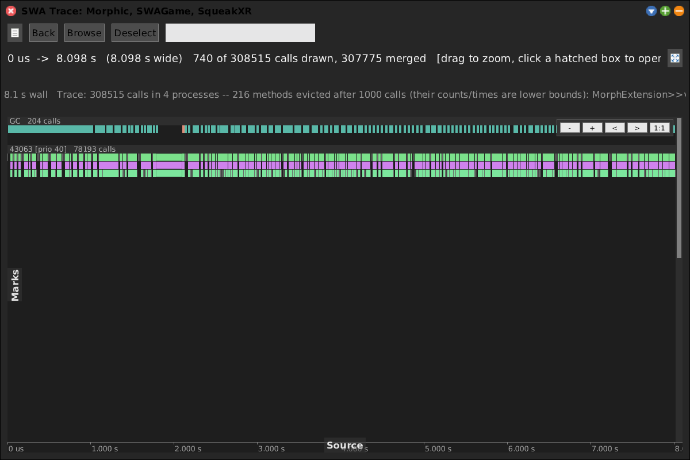
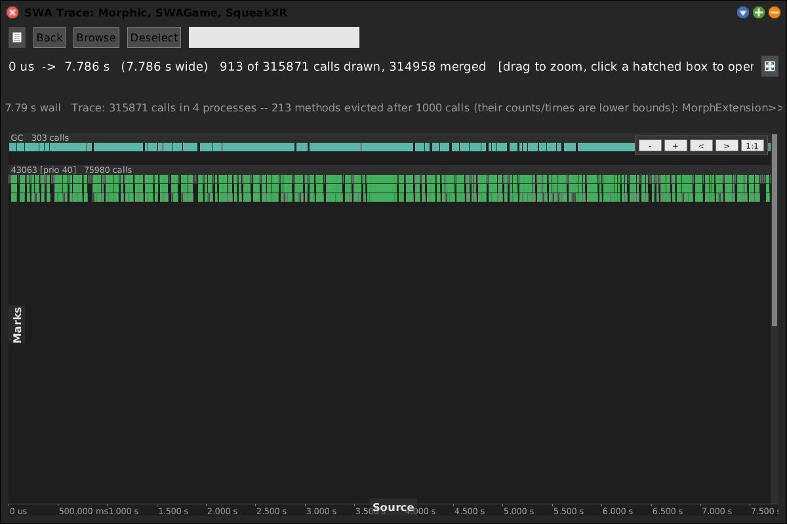

# Trace / Flame Chart

[Gallery index](index.md) · referent **event** · extent **interval** · **Record** (until stop)

> What ran *when*, in which process?

Not a profile -- a **chart**. Every call is retained as an individual span with a
start and a duration, drawn in per-process lanes. Repeated calls, gaps, and
inter-process interleaving are representable only here; totals are not
representable here at all.

**Open:** `SWA Event: Trace (until stop)`, or `SWAPane openTraceUntilStop`.

<!-- SCREENSHOT gallery-trace.png -- Record tool: arm, do something, then STOP. Not scriptable in one go.
| panel |
panel := SWAPane openTraceUntilStop.
"...exercise the one thing you want to see, then:"
panel requestStop.
"...then screenshot the window that opens:"
"PNGReadWriter putForm: w imageForm onFileNamed: 'squeak-object-space-tally/doc/media/gallery-trace.png'."
-->

## The STOP-button pattern

This is the tool the other Record entries copy. Three things about it are
deliberate, and each fixes a bug that was there first:

1. **The STOP button goes up before anything is instrumented.** Wrapping a few
   thousand methods takes a noticeable moment during which Morphic does not
   redraw; arming first leaves the user looking at a frozen image with no way to
   stop what they just started.
2. **Arming is held back two beats**, because the working set usually *contains
   Morphic* -- so whatever the screen is still drawing when recording starts lands
   in the trace, and the first thing at the head of your trace would be this tool
   painting its own STOP button.
3. **Closing the window instead of pressing STOP uninstalls.** Instrumentation
   must never linger.

## Scope

The instrumented set is the **working set** -- the same packages the
[Code Map](code-map.md) shows, edited from the **Packages** list in any pane. That
is the shortcut the working set makes possible: the old route to a trace was *open
a code map, wait for it to tile, pick Data > Generate: call trace, press Stop, then
find Tree > Trace* -- four steps and a treemap you did not want, all of it only to
answer "which packages?".

## Colour modes

*By duration (heat)* -- the outlier span, rather than the repeated one. `By method`
gives each method a stable hue instead, which is what you want when looking for a
repeat rather than a stall.

## Cost

A trace **evicts like a tally but keeps every call it did see**, so its cost is
memory that grows with what you do. The run panel says so: *"do the ONE thing"* is
the honest advice, not "exercise the system".

## Relatives

- [Sampling Tally](sampling-tally.md) / [Sampling Tracer](sampling-tracer.md) --
  totals instead of spans, statistical instead of exact, cheap instead of
  perturbing.
- [Change Trace](change-trace.md) -- the same span view, but over live system
  changes rather than calls.
- The **Invocation** and **Timing** tallies share this instrumentation and the same
  STOP window (`SWAPane>>openTallyStopWindow`), reached from the Code Map's
  **Tally** button. The window's wording differs per kind because what you may do
  while it is open differs.
