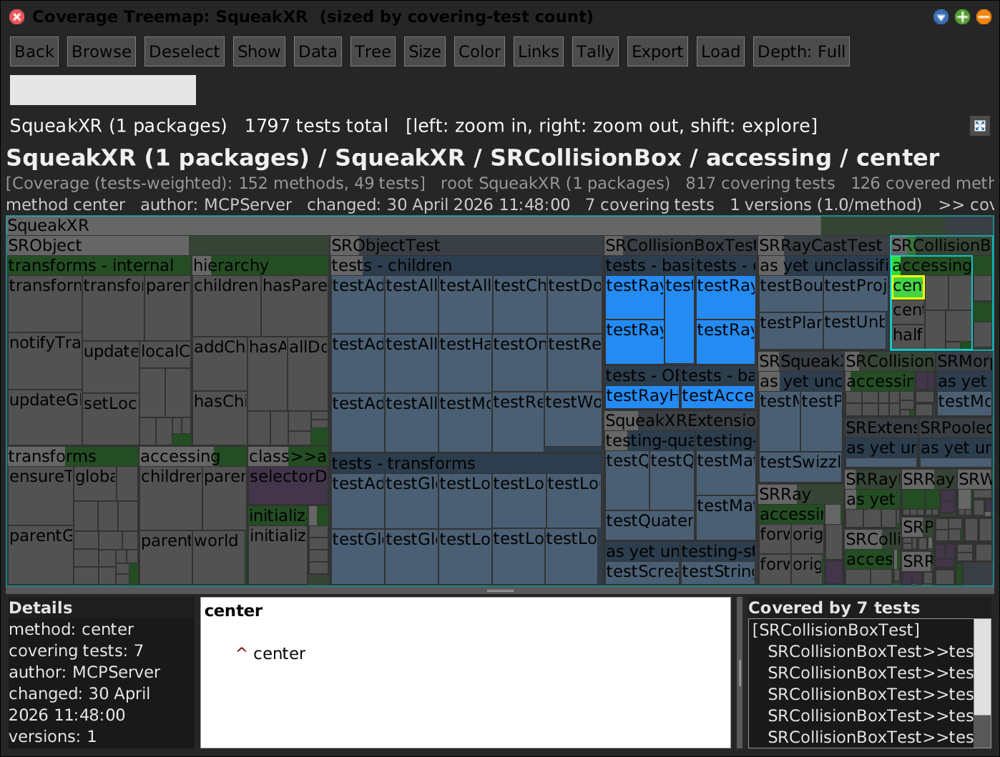

# The Shared View Layer

[Gallery index](index.md) · not a tool -- the substrate every tool is built on.

Three abstractions, all in `SWA-Base`:

- **`SWANode`** -- the tree contract: `parent`/`children`, `depth`, `pathString`,
  `isLeaf`, `withAllChildrenDo:`, and the `crossRefKey` that lets any tool colour
  itself by any other's data. Class names are unique; methods are
  `'Class>>selector'`.
- **`SWAView`** -- the shared `Morph`: `rootNode`, selection, the cached-Form
  render, the `keyIndex`, and the **dataset layer**.
- **`SWAPane`** -- the chrome: **Back / Browse / Deselect / Show / Data / Tree /
  Size / Color / Links**, breadcrumb, two info lines, the toggleable **Show** row
  (details / source / cross-references), the **Marks** flap, and fullscreen.

The header is rebuilt per view and **capability-gated**, so it changes as you morph
one tool into another. A button you do not see is a capability the current view
does not claim.

<!-- SCREENSHOT gallery-viewlayer.png -- needs a fixture: squeakxr-coverage.json alongside
| w tm panel data leaf |
data := SWACoverageData fromFile: 'squeak-object-space-tally/doc/squeakxr-coverage.json'.
w := SWAPane openCoverage: 'squeak-object-space-tally/doc/squeakxr-coverage.json' onPackageNamed: 'SqueakXR' leafKind: nil.
tm := w allMorphs detect: [:m | m isKindOf: SWACodeTreemapMorph].
panel := w allMorphs detect: [:m | m isKindOf: SWAPane].
leaf := nil.
tm rootNode withAllChildrenDo: [:n |
	(leaf isNil and: [(n isKindOf: SWACodeMethodNode) and: [(data coveringTestCountFor: n crossRefKey) >= 2]])
		ifTrue: [leaf := n]].
tm selectTileNode: leaf.
panel toggleSource.
World displayWorld. (Delay forMilliseconds: 700) wait. World displayWorld. (Delay forMilliseconds: 300) wait.
PNGReadWriter putForm: w imageForm onFileNamed: 'squeak-object-space-tally/doc/media/gallery-viewlayer.png'.
w delete.
-->

## Datasets -- the unified data path

A **`SWADataset`** is a named, retained source bound to a view, carrying one or
more **metrics**, each bindable to the colour (and where supported size/links)
axis. Loading the same kind twice gives two coexisting, switchable entries.

Sources: a **file** (coverage, duplication, git churn, space-tally JSON) via the
Code Map's **Load** button, or a **live peer panel** -- every open
treemap/flamegraph appears in the **Data** menu as *"X-ref: `<window>`"*, read
through `SWAPeerViewSource` from the peer's live `keyIndex`.

So one menu answers questions that span views: *colour the Code Map by how much
memory each class measured in a Space Tally*, or *by how often each method has
been committed*.

## Structure -- morph one tool into another

The **Tree** button picks which node tree *is* the base structure. A space tally
loaded from node-tree JSON keeps its tree, so a Code Map can morph in place into
that Space Tally and back -- both views cached, so the switch is instant and
lossless.

## The Packages list

The Marks flap carries a **Packages** section: the package scope this pane rests
on, with `+` / `-` / `Reset` / `Default` buttons (buttons, not just a context menu,
because right-click is awkward in the XR Morphic world).

It shows one of two things, and the title says which:

- **`Packages (n)`** -- this map's own package set. Editing changes only this map.
- **`Working set (n)`** -- the shared Code Map working set, shown when the view has
  no package set of its own. Editing changes what *every other tool* measures:
  `SWAAllocTracer>>tracedClasses` and the Trace's instrumented set are both derived
  from it, live.

Clicking a row calls `revealPackageNode:` on the view. The treemap drills in; the
default is a no-op, because not every view has somewhere to go.

> **Known defect.** In the Space Tally the list is shown but inert: that view's
> `crossRefKey` is a *class* name, so a package row can never resolve to a node,
> and the tally walks `defaultRoots` rather than any package set. Logged as a TODO
> in the journal for 2026-09-22; the proposed fix is to make it highlight the
> classes of those packages rather than hide it.

## Open naming question

Carried over from the single-page gallery this replaced: consider whether
`SWAView` wants a clearer name alongside `SWAPane`. The pair reads as
interchangeable and is not -- `SWAView` is the content morph, `SWAPane` the chrome
that wraps it.

Two renames already done for the same reason: `SWACodeGraphMorph` ->
`SWAClassDiagram`, and `SWANavPanel` -> `SWAPane`.
