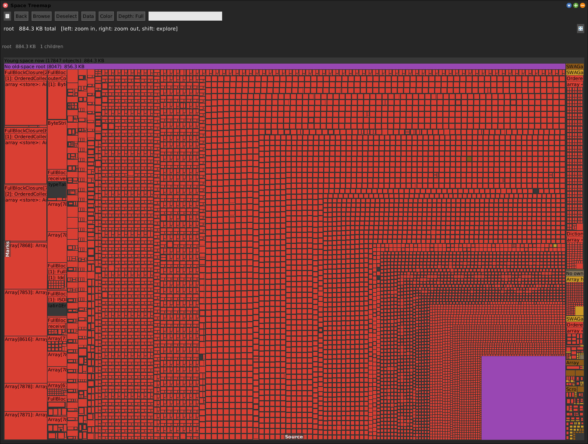
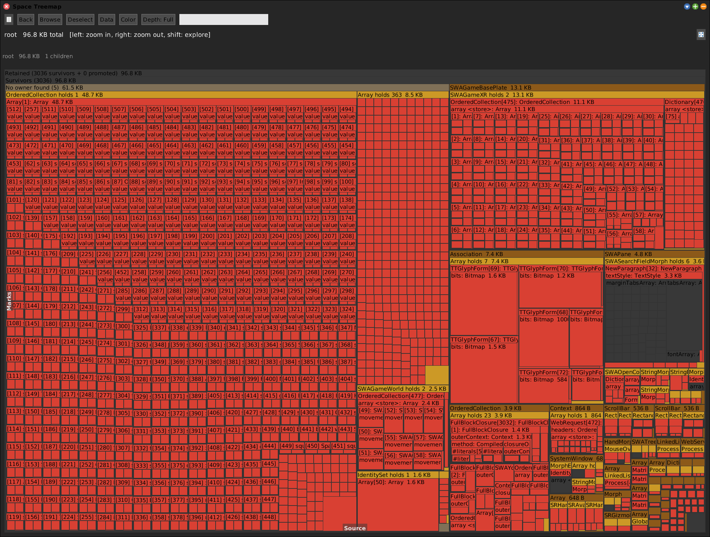
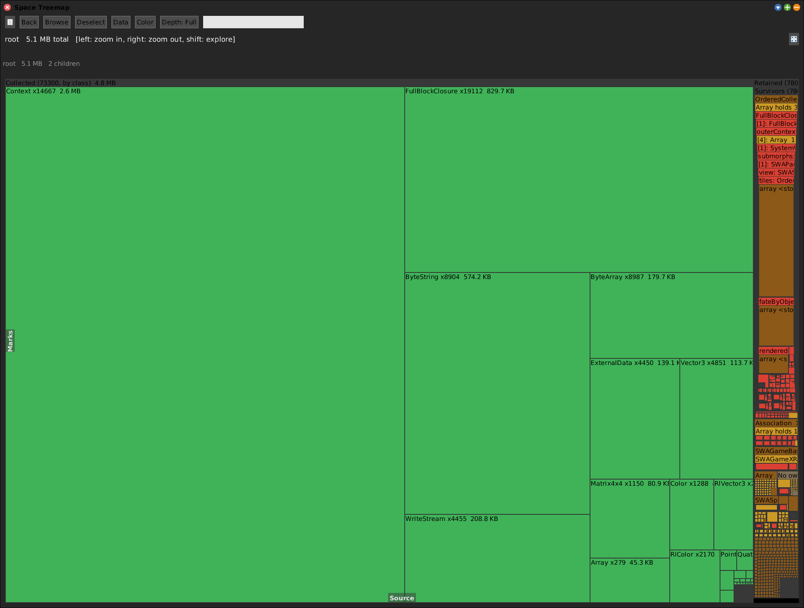
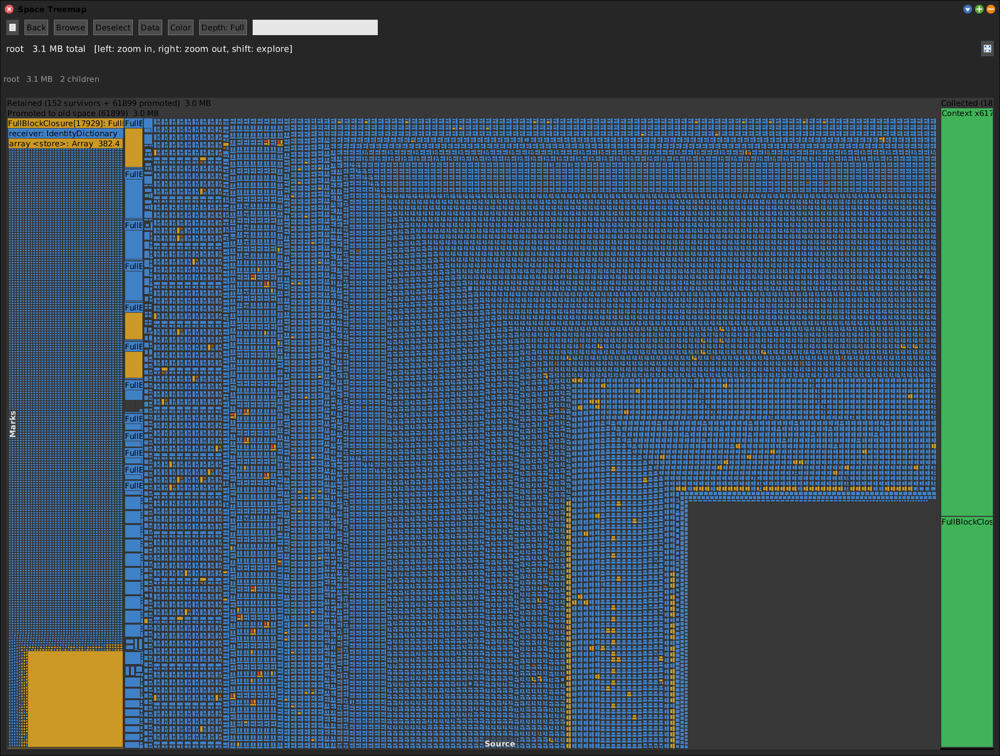

# Young Space

[Gallery index](index.md) · referent **object** · extent **instant** · **Look**

> What is *standing* in young space right now?

A structural treemap of young space, filed under the **old-space objects that
point into it** -- so the answer to "why is this still here" is a retention chain,
not a class census.

Journal: [2026-08-19](../../../journal/2026-08-19-young-space-tally-and-two-dead-ends.md),
[2026-09-22](../../../journal/2026-09-22-young-space-now-and-the-fate-measurement-that-ate-itself.md).

**Open:** `SWA Object: Young Space` -- which **asks which of five views**, because
they differ in the collection they provoke and that choice is not recoverable.

<!-- SCREENSHOT gallery-youngspace.png -- the "now" view: no scavenge, no full GC
| w |
w := SWAYoungSpaceTally openYoungSpaceNow.
World displayWorld. (Delay forMilliseconds: 1500) wait. World displayWorld. (Delay forMilliseconds: 500) wait.
PNGReadWriter putForm: w imageForm onFileNamed: 'squeak-object-space-tally/doc/media/gallery-youngspace.png'.
w delete.
-->

## The five views

| Send | Perturbation | Answers |
|---|---|---|
| `openYoungSpaceNow` | **none** | the population as it stands, garbage included |
| `openRetained` | scavenge | survivors and promoted only, garbage left out |
| `openAges` | 5 scavenges | how many samples each survivor has lasted |
| `openScavengeFate` | one scavenge | survived / tenured / collected |
| `openTreemap` | **full GC** | fate, including the old-space captor of each survivor |

The prompt exists because the choice is destructive: a full GC destroys the very
population `openYoungSpaceNow` reports.

## The variants, pictured

`openRetained` -- garbage left out, so the objects that are actually being kept
are readable rather than lost among transients.

`openScavengeFate` + colour `fate` -- **red survived, blue tenured to old space,
green collected**, with the old-space objects holding each survivor. No full GC.

## How young space is found

Not by a primitive -- there is none. By **move detection**:

- `nextObject` from the heap head walks *old* space only and never reaches young.
- `allObjectsOrNil` reaches all of young, and because its ~21 MB array is large it
  is born directly in **old** space -- so it is invisible to the measurement and
  needs no filtering.
- A young object **moves** on a scavenge; an old object does not. Read every
  address, `garbageCollectMost`, read again: the movers are exactly the live young
  set, complete, with zero old contamination.

Move detection is self-cleaning: our own buffers are old, so they can never be
mistaken for young.

## What is trustworthy here, and what is not

The **retention chain is a direct observation** -- a slot either contains that
object or it does not. That is why `young space now` stands while the fate
machinery built on top of it did not. It named `SRGCFpsGraph`'s frame-time buffer
holding 417 young `Fraction`s: the FPS instrument was itself a young-space
retainer.

The fate passes, the age series and the fingerprint machinery were **removed** on
2026-09-22 -- every failure traced to the same root, that the observer shares the
heap with the observed. The recommended use now:

> Use it as a **class finder, not a fate oracle**. It reliably answers *what is in
> young space and what points at it*. Feed those classes to the
> [Alloc Tracer](alloc-tracer.md) and catch them at the allocation site, where the
> measurement does not have to fight the collector.

## Ages

`openAges` samples young space five times, one scavenge apart, and colours the
survivors by **how many samples they have lasted** -- cool = fresh, hot = still
here after every scavenge. The hot tiles are the standing floor; the cool ones are
this instant's churn.

## Versus Heap Diff

See [heap-diff.md](heap-diff.md). Short version: a diff is bounded by an action you
supply, young space by the collector. A step that allocates nothing still has a
young space.
